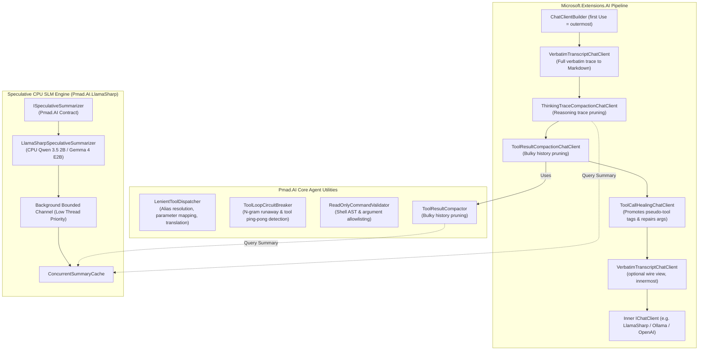

# Pmad.AI Agent Utilities & Speculative Compaction Plan

> **Design & Implementation Plan**  
> **Target Framework:** .NET 10.0 (Native AOT Compatible)  
> **Source Projects:** [`NightCodeForge.Agents`](file:///C:/Users/Julien/source/repos/jetelain/NightCodeForge/src/NightCodeForge.Agents) & [`NightCodeForge/docs/SPECULATIVE_CPU_SLM_COMPACTION.md`](file:///C:/Users/Julien/source/repos/jetelain/NightCodeForge/docs/SPECULATIVE_CPU_SLM_COMPACTION.md)  
> **Target Projects:** [`Pmad.AI`](file:///C:/Users/Julien/source/repos/jetelain/PmadAI/src/Pmad.AI) & [`Pmad.AI.LlamaSharp`](file:///C:/Users/Julien/source/repos/jetelain/PmadAI/src/Pmad.AI.LlamaSharp)

---

## 1. Executive Summary

This document establishes the architecture and roadmap for expanding **Pmad.AI** with battle-tested agent utilities, resilient tool-calling infrastructure, conversation history compactors, and speculative CPU SLM background summarization adapted from [NightCodeForge.Agents](file:///C:/Users/Julien/source/repos/jetelain/NightCodeForge/src/NightCodeForge.Agents).

### Core Goals
1. **Preserve Native AOT & Low-Dependency Footprint:** Core utilities in [Pmad.AI](file:///C:/Users/Julien/source/repos/jetelain/PmadAI/src/Pmad.AI) will remain trim-safe, reflection-free, and depend only on `Microsoft.Extensions.AI` and `Microsoft.Extensions.Logging.Abstractions`.
2. **First-Class `IChatClient` Middleware:** Package resilience features (tool call healing, reasoning trace compaction) as idiomatic `DelegatingChatClient` pipelines compatible with `ChatClientBuilder`.
3. **Configurable & Pluggable Architecture:** Tool dispatching, shell command validation, and compaction summarization will be fully configurable via options and dependency injection rather than tied to hardcoded domains.
4. **Speculative CPU SLM Compaction:** Connect [Pmad.AI.LlamaSharp](file:///C:/Users/Julien/source/repos/jetelain/PmadAI/src/Pmad.AI.LlamaSharp) to background compaction queues, utilizing idle CPU threads to generate compact semantic summaries (lossy by nature, with a deterministic fallback always available), aiming for minimal GPU VRAM impact (to be validated, see §4.7) and no per-turn latency overhead.

---

## 2. Architecture Overview



> [!TIP]
> **Pipeline Placement Semantics:**
> - **Healing must be innermost:** `ToolCallHealingChatClient` sits directly above the inner client so it sees the raw model output; all outer layers (including audit logging) see healed tool calls. Compaction only rewrites the *request*, so the relative order of the two compaction clients is irrelevant.
> - **Audit View (Outermost):** `VerbatimTranscriptChatClient` as the first `Use*` call captures the caller's pristine conversation input and the final healed tool calls.
> - **Wire / Diagnostic View (Innermost):** A second `VerbatimTranscriptChatClient` instance registered last (directly above `InnerClient`, below healing) captures the exact compacted prompt sent to the model and the raw, unhealed output.
> - **`MutateInPlace = true` and audit logging:** In-place compaction mutates the caller's messages, so an outer audit transcript would record compacted data. Do not combine `MutateInPlace = true` with an outer `VerbatimTranscriptChatClient`.

---

## 3. Scope & Selected Components

The implementation is organized into eight components:

| Component | Target Library | Primary Responsibility |
|---|---|---|
| **`VerbatimTranscriptChatClient`** | `Pmad.AI` | Middleware logging verbatim turns, prompts, reasoning traces, tool schemas/calls, and token usage into standalone Markdown files. |
| **`ToolCallHealingChatClient`** | `Pmad.AI` | Middleware wrapping `IChatClient` (streaming + non-streaming) that promotes pseudo `<tool_call>` tags into `FunctionCallContent`. |
| **`ThinkingTraceCompactionChatClient`** | `Pmad.AI` | Middleware compacting historical `TextReasoningContent` outside the active turn window. |
| **`ToolResultCompactionChatClient`** & **`ToolResultCompactor`** | `Pmad.AI` | Conversation history optimizer and middleware that trims bulky tool outputs outside the active turn window. |
| **`ToolLoopCircuitBreaker`** | `Pmad.AI` | Detects streaming $n$-gram repetition loops and repetitive tool invocation ping-pong. |
| **`LenientToolDispatcher`** | `Pmad.AI` | Configurable tool router with alias resolution, parameter translation, and JSON argument normalization. |
| **`ReadOnlyCommandValidator`** | `Pmad.AI` | Security filter validating shell commands in unprivileged/read-only agent environments. |
| **`LlamaSharpSpeculativeSummarizer`** | `Pmad.AI.LlamaSharp` | Background CPU-only SLM worker generating precomputed summaries for compaction hooks. |

---

## 4. Component Specifications

### 4.1 `ToolCallHealingChatClient` (Core Middleware)
* **Inspired by:** [`LenientToolCallChatClient.cs`](file:///C:/Users/Julien/source/repos/jetelain/NightCodeForge/src/NightCodeForge.Agents/Inference/LenientToolCallChatClient.cs) & [`ToolCallHealingTransform.cs`](file:///C:/Users/Julien/source/repos/jetelain/PmadAI/src/Pmad.AI/ToolCallHealingTransform.cs)
* **Target:** `Pmad.AI`

#### Capabilities
- Inherits from `Microsoft.Extensions.AI.DelegatingChatClient`.
- In `GetResponseAsync`, executes `ToolCallHealingTransform.HealChatResponse(response, logger)`.
- In `GetStreamingResponseAsync`, provides configurable buffering strategies to balance protocol recovery with low Time-To-First-Token (TTFT) for regular text.
- Reuses the zero-allocation source-generated regexes and JSON parsing from [ToolCallHealingTransform.cs](file:///C:/Users/Julien/source/repos/jetelain/PmadAI/src/Pmad.AI/ToolCallHealingTransform.cs).

#### Configuration & Performance Options
```csharp
public enum StreamingHealingMode
{
    /// <summary>Only buffers stream chunks when potential pseudo-tool tag prefixes are encountered, preserving TTFT for prose.</summary>
    PrefixTriggered,
    /// <summary>Buffers entire stream until completion before parsing (100% extraction rate at the cost of streaming latency).</summary>
    FullBuffer,
    /// <summary>Disables streaming healing; passes streaming updates untouched for maximum performance.</summary>
    Disabled
}

public class ToolCallHealingOptions
{
    /// <summary>Streaming mode strategy. Defaults to PrefixTriggered.</summary>
    public StreamingHealingMode StreamingMode { get; set; } = StreamingHealingMode.PrefixTriggered;

    /// <summary>Prefix triggers that activate stream chunk buffering.</summary>
    /// Prefixes may be split across chunk boundaries (e.g. "<tool" + "_call>"); the buffer matches partial prefixes at the tail of the accumulated text.
    /// A bare "<" is intentionally NOT a trigger (HTML, generics and markdown would defeat the TTFT guarantee).
    public string[] TagPrefixTriggers { get; set; } = ["<tool_call", "<function_call"];
    // "Action:" is deliberately not a default trigger: it appears in ordinary prose and would defeat the TTFT guarantee.
    // Opt in explicitly for models that emit ReAct-style text.

    /// <summary>Optional logger.</summary>
    public ILogger? Logger { get; set; }
}
```

- **`PrefixTriggered` semantics:** text is forwarded immediately unless the tail of the accumulated text is a (partial) trigger prefix. Once a trigger is matched, the client buffers until the matching closing tag is seen, or until the stream ends, then promotes the content to `FunctionCallContent`. If a trigger prefix turns out not to complete (e.g. `<tool` followed by other text), the held text is flushed unchanged.
- Provides extension methods:
  ```csharp
  public static ChatClientBuilder UseToolCallHealing(
      this ChatClientBuilder builder,
      Action<ToolCallHealingOptions>? configure = null);

  // The logger is supplied via ToolCallHealingOptions.Logger; no ILogger overload
  // (avoids an ambiguous UseToolCallHealing(null) call).
  ```

---

### 4.2 `ThinkingTraceCompactionChatClient` (Reasoning History Optimizer)
* **Inspired by:** [`ThinkingTraceCompactionChatClient.cs`](file:///C:/Users/Julien/source/repos/jetelain/NightCodeForge/src/NightCodeForge.Agents/Optimizations/ThinkingTraceCompactionChatClient.cs)
* **Target:** `Pmad.AI`

#### Capabilities
- Middleware pruning or summarizing `TextReasoningContent` from older assistant messages outside a configurable `KeepVerbatimCount` window (default: 10). The window is counted newest-first in **assistant messages that contain reasoning**.
- Supports an optional `ISpeculativeSummarizer` interface:
  - If a precomputed summary exists for the message ID, replaces historical thought with `[Reasoned Summary: <summary>]`.
  - If no summary is available, falls back to the deterministic first-line stub (`[Reasoned: <first line>...]`).
- Prevents 60%–80% prompt token inflation in multi-turn reasoning conversations.

#### Configuration & Performance Options
```csharp
public class ThinkingTraceCompactionOptions
{
    /// <summary>Number of recent assistant reasoning turns to retain verbatim. Default: 10.</summary>
    public int KeepVerbatimCount { get; set; } = 10;

    /// <summary>Maximum character length of the fallback deterministic reasoning stub. Default: 120.</summary>
    public int FallbackCharacterLimit { get; set; } = 120;

    /// <summary>Whether to truncate fallback text at the first newline if shorter than FallbackCharacterLimit. Default: true.</summary>
    public bool FallbackTruncateAtFirstLine { get; set; } = true;

    /// <summary>Format string for deterministic fallback stub. Default: "[Reasoned: {0}...]"</summary>
    public string FallbackFormat { get; set; } = "[Reasoned: {0}...]";

    /// <summary>
    /// When true, modifies the passed ChatMessage list and instances in-place (zero-allocations).
    /// When false (default), returns a shallow copy with modified messages, ensuring caller's
    /// conversation history remains pristine and immutable.
    /// </summary>
    public bool MutateInPlace { get; set; } = false;

    /// <summary>Optional background SLM summarizer.</summary>
    public ISpeculativeSummarizer? Summarizer { get; set; }

    /// <summary>Resolves the session id used to scope summaries. See §4.7 (default: ChatOptions.ConversationId, then "default").</summary>
    public Func<ChatOptions?, string>? SessionIdResolver { get; set; }
}

public class ThinkingTraceCompactionChatClient : DelegatingChatClient
{
    public ThinkingTraceCompactionChatClient(IChatClient innerClient, ThinkingTraceCompactionOptions? options = null);
}

public static class ThinkingTraceCompactionChatClientExtensions
{
    public static ChatClientBuilder UseThinkingTraceCompaction(
        this ChatClientBuilder builder,
        Action<ThinkingTraceCompactionOptions>? configure = null);

    public static ChatClientBuilder UseThinkingTraceCompaction(
        this ChatClientBuilder builder,
        ISpeculativeSummarizer? summarizer,
        int keepVerbatimCount = 10,
        int fallbackCharacterLimit = 120);
}
```

#### Message Identity Strategy
Because `Microsoft.Extensions.AI.ChatMessage` lacks a native ID, `itemKey` and `sessionId` resolution follows the single canonical strategy defined in [§4.7](#47-speculative-cpu-slm-compaction-engine) (shared by both compaction clients). Keys are computed only from the target content (the reasoning text), never from the whole message, so rewrites by the other compaction client or earlier in-place mutation cannot change them.

---

### 4.3 `ToolLoopCircuitBreaker` (Safety & Loop Protection)
* **Inspired by:** [`ToolLoopCircuitBreaker.cs`](file:///C:/Users/Julien/source/repos/jetelain/NightCodeForge/src/NightCodeForge.Agents/Optimizations/ToolLoopCircuitBreaker.cs)
* **Target:** `Pmad.AI`

#### Capabilities
- **$N$-Gram Repetition Detector (`DetectStreamingRepetition`):**
  - Scans streaming text buffers for repeating character sequences (e.g. $\ge 16$ characters repeated $\ge 3$ times).
  - Triggers early stream cancellation when local models enter infinite generation stutter loops.
- **Tool Ping-Pong Detector (`EvaluateToolInvocation`):**
  - Tracks invocation signature across turns against workspace state signatures.
  - Detects duplicate calls on unchanged state, returning a structured diagnostic warning (`LoopCheckResult`).

#### Configuration & Performance Options
```csharp
public class ToolLoopCircuitBreakerOptions
{
    /// <summary>
    /// When true (default), parses and sorts JSON argument keys before hashing, preventing key
    /// permutation false-negatives (e.g. {"a":1,"b":2} vs {"b":2,"a":1}).
    /// Set to false to bypass JSON parsing and perform raw string SHA-256 for maximum throughput.
    /// </summary>
    public bool CanonicalizeJsonArguments { get; set; } = true;

    /// <summary>Minimum repeating n-gram length in streaming text. Default: 16.</summary>
    public int NgramMinLength { get; set; } = 16;

    /// <summary>Minimum occurrence count to trip repetition breaker. Default: 3.</summary>
    public int NgramMinOccurrences { get; set; } = 3;

    /// <summary>Maximum tool invocation history entries kept for ping-pong detection. Default: 50.</summary>
    public int MaxToolHistory { get; set; } = 50;

    /// <summary>Consecutive identical invocations (same name, canonical arguments and state signature) that trip the ping-pong breaker. Default: 2 (the 2nd identical call is flagged).</summary>
    public int PingPongThreshold { get; set; } = 2;
}

public enum LoopType { None, StreamingRepetition, ToolPingPong }

public record LoopCheckResult(
    bool IsLoopDetected,
    LoopType Type,
    string DiagnosticMessage,
    string? ToolName = null);

public sealed class ToolLoopCircuitBreaker
{
    public ToolLoopCircuitBreaker(ToolLoopCircuitBreakerOptions? options = null);

    /// <summary>Called with the accumulated streaming text; returns a detection result so the caller can cancel the stream.</summary>
    public LoopCheckResult DetectStreamingRepetition(ReadOnlySpan<char> accumulatedText);

    /// <summary>
    /// Records a tool invocation. <paramref name="stateSignature"/> is an opaque caller-supplied token
    /// (e.g. hash of workspace/file state). When null, state is considered unknown and only
    /// consecutive identical calls are flagged.
    /// </summary>
    public LoopCheckResult EvaluateToolInvocation(string toolName, string argumentsJson, string? stateSignature = null);

    /// <summary>Clears history (e.g. between tasks).</summary>
    public void Reset();
}
```

The breaker is a plain utility (not middleware); the harness owns the call sites and the cancellation policy.

- **Scope & threading:** one instance per session/task; instances are not thread-safe. Do not share them across concurrent sessions.
- **Cost:** `DetectStreamingRepetition` only scans a bounded tail window of the accumulated text (about `NgramMinLength * NgramMinOccurrences` characters plus slack), so per-chunk cost is O(1) rather than O(n²).

---

### 4.4 Declarative & Validated `LenientToolDispatcher`
* **Inspired by:** [`LenientToolDispatcher.cs`](file:///C:/Users/Julien/source/repos/jetelain/NightCodeForge/src/NightCodeForge.Agents/Dispatcher/LenientToolDispatcher.cs)
* **Target:** `Pmad.AI` (Core library) & `Pmad.AI.SourceGenerators` (Analyzer + Generator)

#### Problem Statement & Design Objectives
In NightCodeForge, tool dispatching required dozens of procedural C# calls (`RegisterAlias`, `RegisterParameterAlias`, `RegisterTranslation`). This pattern is:
1. **Error-prone:** Typos in target tool or parameter names silently fail at runtime without compiler checks.
2. **Boilerplate-heavy:** Clutters startup code with procedural dictionaries and lambda expressions.
3. **Rigid:** Difficult to customize per workspace, environment, or agent persona without modifying C# source files.

To solve this, `LenientToolDispatcher` in `Pmad.AI` adopts a **code-first, validated, metadata-driven architecture** combining:
- **Code-First Object Model:** Configure mappings and translation rules via strongly-typed `ToolDispatcherConfiguration` instances constructed directly in C# code or emitted by the compile-time source generator. No runtime JSON parsing, schema files, or embedded resources.
- **Two-Way Schema Validation:** Verifies at startup that every configured tool and parameter alias resolves to a real, registered `AIFunction` and matches its `JsonSchema`.
- **Attribute Model (source-generator only):** Decorate C# methods and parameters with `[ToolAlias]`, `[ToolParameterAlias]`, and `[ToolTranslation]`. The attributes are **never read at runtime**; the Roslyn generator consumes them at compile time and emits a static method returning a `ToolDispatcherConfiguration` instance.
- **Roslyn Incremental Source Generator (configuration emitter only):** Compile-time validation analyzers (detecting misspelled parameter aliases before build) and generation of a static `ToolDispatcherConfiguration` factory method. No JSON, no embedded resources, no runtime reflection.

---

#### 1. Strongly-Typed Configuration Model (`ToolDispatcherConfiguration`)
The dispatcher is configured via strongly-typed C# objects, completely eliminating runtime JSON parsing overhead and dependencies:

```csharp
public class ToolDispatcherConfiguration
{
    public Dictionary<string, ToolMapping> Tools { get; init; } = new(StringComparer.OrdinalIgnoreCase);
    public List<ToolTranslation> Translations { get; init; } = [];
}

public class ToolMapping
{
    public HashSet<string> Aliases { get; init; } = new(StringComparer.OrdinalIgnoreCase);
    public Dictionary<string, HashSet<string>> ParameterAliases { get; init; } = new(StringComparer.OrdinalIgnoreCase);

    public ToolMapping() { }

    public ToolMapping(
        IEnumerable<string>? aliases = null,
        IDictionary<string, IEnumerable<string>>? parameterAliases = null)
    {
        if (aliases is not null)
        {
            foreach (var alias in aliases)
            {
                Aliases.Add(alias);
            }
        }

        if (parameterAliases is not null)
        {
            foreach (var (param, pAliases) in parameterAliases)
            {
                ParameterAliases[param] = new HashSet<string>(pAliases, StringComparer.OrdinalIgnoreCase);
            }
        }
    }
}

public enum ParameterEscapeMethod
{
    None,
    Bash,
    PowerShell
}

public class ToolTranslation
{
    public required string SourceTool { get; init; }
    public required string TargetTool { get; init; }
    public required string CommandTemplate { get; init; }
    public ParameterEscapeMethod EscapeMethod { get; init; } = ParameterEscapeMethod.Bash;
}
```

##### Example Programmatic Configuration:
```csharp
var config = new ToolDispatcherConfiguration
{
    Tools =
    {
        ["read"] = new ToolMapping(
            aliases: ["read_file", "view_file", "cat", "examine_file"],
            parameterAliases: new Dictionary<string, IEnumerable<string>>
            {
                ["path"] = ["filePath", "file_path", "filename", "file"],
                ["offset"] = ["start_line", "startLine", "line_offset"],
                ["limit"] = ["max_lines", "maxLines", "count"]
            }),
        ["edit"] = new ToolMapping(
            aliases: ["edit_file", "replace_file_content", "patch"],
            parameterAliases: new Dictionary<string, IEnumerable<string>>
            {
                ["path"] = ["filePath", "file_path", "targetFile"],
                ["edits"] = ["chunks", "replacements", "diffs"],
                ["old_text"] = ["oldText", "targetContent", "target_content"],
                ["new_text"] = ["newText", "replacementContent", "replacement_content"]
            }),
        ["bash"] = new ToolMapping(
            aliases: ["terminal", "shell", "run_command", "cmd", "exec"],
            parameterAliases: new Dictionary<string, IEnumerable<string>>
            {
                ["command"] = ["cmd", "commandLine", "command_line", "script"]
            })
    },
    Translations =
    [
        new()
        {
            SourceTool = "list_dir",
            TargetTool = "bash",
            CommandTemplate = "ls -la -- {path:.}",
            EscapeMethod = ParameterEscapeMethod.Bash
        },
        new()
        {
            SourceTool = "grep_search",
            TargetTool = "bash",
            CommandTemplate = "rg -n -- {query} {path:.}",
            EscapeMethod = ParameterEscapeMethod.Bash
        },
        new()
        {
            SourceTool = "find_files",
            TargetTool = "bash",
            CommandTemplate = "find -- {path:.} -name {pattern:*}",
            EscapeMethod = ParameterEscapeMethod.Bash
        }
    ]
};
```

##### Security & Parameter Escaping (`ParameterEscapeMethod`)
- **Per-Translation `EscapeMethod`:** Each translation specifies how substituted parameters are sanitized before rendering `CommandTemplate`:
  - **`ParameterEscapeMethod.Bash` (default):** Quotes parameters using POSIX single-quotes (`'...'`) and escapes internal single quotes as `'\''`, neutralizing shell metacharacters (`;`, `&`, `|`, `$()`, backticks, redirection).
  - **`ParameterEscapeMethod.PowerShell`:** Quotes parameters using PowerShell single-quotes and doubles internal quotes (`''`), preventing variable expansion and subexpression execution.
  - **`ParameterEscapeMethod.None`:** Performs raw string substitution without quoting or escaping (for internal identifiers, numbers, or when parameters are already strictly pre-validated).
- **`ValidateTranslationsWithReadOnlyValidator` (default: `true`):** Automatically routes rendered shell commands through `ReadOnlyCommandValidator` before execution. If `LenientToolDispatcherOptions.CommandValidator` is null, a default `ReadOnlyCommandValidator` is constructed; validation is never skipped silently.
- **Option injection:** quoting does not stop a value such as `--pre=cmd` from being parsed as an option. Templates must place `--` before user-supplied positional values (as in the examples above), and the dispatcher rejects substituted values that begin with `-` for any parameter not explicitly marked as a flag-safe value.
- **Template rules:** `{name}` denotes a required parameter; `{name:default}` supplies a default value when the parameter is absent. A missing required parameter yields a dispatch error, never an empty substitution.
- **Binary availability:** Translations such as `rg`/`find` assume those binaries exist on the target host; the translation is skipped (with a diagnostic) when the host profile does not list the target binary.

---

#### 2. Startup Schema Validation Against Registered `AIFunction` Instances
To guarantee that configured tool mappings never drift from actual C# tool definitions, `LenientToolDispatcher` exposes a strict `Validate()` method:

```csharp
public record ToolValidationIssue(
    ToolValidationSeverity Severity,
    string ToolName,
    string? ParameterName,
    string Message);

public enum ToolValidationSeverity { Warning, Error }

public class ToolDispatcherValidationReport
{
    public bool IsValid => Issues.All(i => i.Severity != ToolValidationSeverity.Error);
    public IReadOnlyList<ToolValidationIssue> Issues { get; init; } = Array.Empty<ToolValidationIssue>();

    public void ThrowIfInvalid()
    {
        if (!IsValid)
        {
            var errors = string.Join("\n", Issues.Where(i => i.Severity == ToolValidationSeverity.Error).Select(i => $"  - {i.Message}"));
            throw new ToolDispatcherValidationException($"LenientToolDispatcher validation failed:\n{errors}");
        }
    }
}
```

##### Validation Rules Enforced:
1. **Tool Existence Check:** Every tool entry in `tools: { "<name>": ... }` and every translation `targetTool` must match an actual registered `AIFunction.Name`. If a tool is missing, an `Error` is reported.
2. **Parameter Schema Inspection:** For every parameter alias in `parameterAliases: { "<targetParam>": ["alias1", ...] }`, the validator inspects the `AIFunction.JsonSchema` (extracting the `properties` dictionary):
   - If `targetParam` does not exist in the schema `properties`, an `Error` is reported (`"Configured parameter alias targets non-existent parameter 'path' on tool 'read'"`).
   - Prevents silent failures when parameter names are refactored in C#.
3. **Alias Collision Detection:** Checks for conflicting tool aliases across distinct canonical tools. Resolution is deterministic: an exact canonical tool name always wins over an alias; between two aliases, first-configured wins. Every collision is reported as a `Warning`; a collision within a single tool's mapping is an `Error`.

---

#### 3. Attributes (Consumed Only by the Source Generator)
For code-first tool definitions, developers decorate their C# methods and parameters with declarative marker attributes. The dispatcher itself has no dependency on these attributes at runtime:

```csharp
namespace Pmad.AI;

[AttributeUsage(AttributeTargets.Method, AllowMultiple = true)]
public sealed class ToolAliasAttribute : Attribute
{
    public string[] Aliases { get; }

    /// <summary>
    /// Explicit canonical tool name matching the registered AIFunction.Name.
    /// Recommended to avoid ambiguity between C# method names and tool names.
    /// If null or omitted, defaults to the method name with a trailing "Async" stripped, exactly as AIFunctionFactory.Create does (no case conversion).
    /// </summary>
    public string? Name { get; set; }

    public ToolAliasAttribute(params string[] aliases)
    {
        Aliases = aliases;
    }

    // Intentionally a single constructor: a (string name, params string[] aliases) overload would win
    // overload resolution and silently turn the first alias into the canonical name. Use the Name property.
}

[AttributeUsage(AttributeTargets.Parameter, AllowMultiple = true)]
public sealed class ToolParameterAliasAttribute(params string[] aliases) : Attribute
{
    public string[] Aliases => aliases;
}

[AttributeUsage(AttributeTargets.Method, AllowMultiple = true)]
public sealed class ToolTranslationAttribute(string sourceToolName, string commandTemplate) : Attribute
{
    public string SourceToolName => sourceToolName;
    public string CommandTemplate => commandTemplate;
    public ParameterEscapeMethod EscapeMethod { get; set; } = ParameterEscapeMethod.Bash;
}
```

##### Usage in Tool Implementations:

###### Style A: Static or Instance Method Declarations
```csharp
public static class WorkspaceTools
{
    [Description("Reads a workspace file with line offset and count.")]
    [ToolAlias("read_file", "view_file", "cat", Name = "read")]
    public static async Task<string> ReadAsync(
        [Description("Relative path"), ToolParameterAlias("filePath", "file_path", "filename")] string path,
        [Description("1-based line offset"), ToolParameterAlias("start_line", "line_offset")] int? offset = null,
        [Description("Max lines to read"), ToolParameterAlias("max_lines", "count")] int? limit = null,
        CancellationToken ct = default)
    {
        // Implementation
        return await File.ReadAllTextAsync(path, ct);
    }
}
```

###### Style B: Lambdas & Delegates in `AIFunctionFactory.Create`
In modern C#, attributes can be placed directly on lambda expressions (`[ToolAlias(...)] (...) =>`) and lambda parameters (`[ToolParameterAlias(...)] string path`). The source generator recognizes both:

```csharp
var editTool = AIFunctionFactory.Create(
    [ToolAlias("edit_file", "replace_file_content", "patch")]
    ([Description("Workspace-relative path to edit"), ToolParameterAlias("filePath", "file_path", "targetFile")] string path,
     [Description("One or more disjoint edits applied in order; each oldText must match the file exactly once"), ToolParameterAlias("chunks", "replacements", "diffs")] IReadOnlyList<EditChunk>? edits = null,
     [Description("Shortcut for a single edit: exact character sequence to be replaced"), ToolParameterAlias("oldText", "targetContent", "target_content")] string? old_text = null,
     [Description("Shortcut for a single edit: replacement character sequence"), ToolParameterAlias("newText", "replacementContent", "replacement_content")] string? new_text = null,
     CancellationToken ct = default) =>
    {
        if (edits is { Count: > 0 })
        {
            return tools.EditAsync(path, edits, ct);
        }

        if (old_text != null && new_text != null)
        {
            return tools.EditAsync(path, old_text, new_text, ct);
        }

        return Task.FromResult("Error: provide 'edits' (array of { oldText, newText }) or both 'old_text' and 'new_text'.");
    },
    "edit",
    "Replaces exact text snippets in a workspace file. Use 'edits' for one or several disjoint replacements in a single call.");
```

##### How Tool Names are Resolved:
1. **Explicit `Name` Property:** Developers can set `[ToolAlias("read_file", "cat", Name = "read")]` (all positional arguments are aliases; there is no name-first overload). When `Name` is specified, the generator binds aliases directly to that exact canonical tool name.
2. **Contextual Inference from `AIFunctionFactory.Create` (Lambdas):** When `[ToolAlias]` is placed on an inline lambda passed to `AIFunctionFactory.Create(lambda, name: "edit", ...)`, the generator automatically extracts the tool name from the constant literal `"edit"` (or `AIFunctionFactoryCreateOptions.Name`), requiring no redundant `Name = "edit"` specification.
3. **Default Method Name Inference Fallback (Methods):** When `[ToolAlias]` is on a method and `Name` is omitted:
   - Strips a trailing `"Async"` suffix if present (e.g. `ReadAsync` -> `Read`), matching the `AIFunctionFactory.Create` default.
   - Performs no case conversion; if the tool is registered as `read`, set `Name = "read"` explicitly (the generator reports a warning when the inferred name differs from the conventional snake_case).
4. **Startup Schema Verification:** `LenientToolDispatcher.Validate()` verifies that every canonical tool name in `Tools` matches an actual registered `AIFunction.Name`. If a tool is registered under a custom name, `Validate()` flags any discrepancy with an `Error`.

##### Metadata Flow (Generated Configuration Object, No Runtime Reflection):
1. At compile time, `Pmad.AI.SourceGenerators` reads `[ToolAlias]`, `[ToolParameterAlias]` and `[ToolTranslation]` on both methods and lambdas, emitting a static factory, e.g.:
   ```csharp
   // <auto-generated/>
   internal static partial class GeneratedToolMappings
   {
       public static ToolDispatcherConfiguration Create() => new()
       {
           Tools =
           {
               ["read"] = new ToolMapping(
                   aliases: ["read_file", "view_file", "cat"],
                   parameterAliases: new() { ["path"] = ["filePath", "file_path", "filename"], ["offset"] = ["start_line", "line_offset"] }),
               ["edit"] = new ToolMapping(
                   aliases: ["edit_file", "replace_file_content", "patch"],
                   parameterAliases: new()
                   {
                       ["path"] = ["filePath", "file_path", "targetFile"],
                       ["edits"] = ["chunks", "replacements", "diffs"],
                       ["old_text"] = ["oldText", "targetContent", "target_content"],
                       ["new_text"] = ["newText", "replacementContent", "replacement_content"]
                   })
           },
           Translations =
           {
               new ToolTranslation
               {
                   SourceTool = "list_dir",
                   TargetTool = "bash",
                   CommandTemplate = "ls -la -- {path:.}",
                   EscapeMethod = ParameterEscapeMethod.Bash
               }
           }
       };
   }
   ```
   `ToolDispatcherConfiguration`, `ToolMapping`, and `ToolTranslation` are plain public types in `Pmad.AI`.
2. At runtime the application calls `dispatcher.Configure(GeneratedToolMappings.Create())`. The dispatcher knows nothing about the attributes and never inspects `AIFunction.AdditionalProperties` or uses reflection.
3. Applications can also construct or augment `ToolDispatcherConfiguration` directly in C# code without the source generator. Startup `Validate()` checks everything against the real `AIFunction.JsonSchema`.

> [!IMPORTANT]
> Without the source generator, the attributes have no effect. This is deliberate: attribute discovery through `MethodInfo` reflection is not trim/AOT-safe and is out of scope.

---

#### 4. Roslyn Incremental Source Generator (`Pmad.AI.SourceGenerators`)

> [!NOTE]
> **Implementation Phasing for Tool Dispatching:**
> - **Phase 2A (Runtime Object Model Configuration & Validation):** Defines the `ToolDispatcherConfiguration` object model, configures it directly in C#, and validates against `AIFunction.JsonSchema`. Because these are standard reflection-free data structures, this is **100% Native AOT trim-safe**. Attributes are not processed in this phase.
> - **Phase 2B (Roslyn Incremental Source Generator):** Implements `Pmad.AI.SourceGenerators` to provide compile-time diagnostic analyzers (`PMAD001`, `PMAD002`, `PMAD003`) and to emit a static `ToolDispatcherConfiguration` factory from the attributes.

To guarantee **100% Native AOT compatibility** and zero runtime reflection overhead, an accompanying source generator package provides:

1. **Compile-Time Diagnostic Analyzers:**
   - **`PMAD001` (Diagnostic Error):** Emitted when a `[ToolParameterAlias]` alias equals the name of another parameter of the same method/lambda, or is duplicated within the same tool.
   - **`PMAD002` (Diagnostic Warning):** Emitted when duplicate tool aliases are declared across distinct methods/lambdas.
   - **`PMAD003` (Diagnostic Error):** Emitted when `[ToolAlias]` is placed on a lambda expression without `Name` and outside of an `AIFunctionFactory.Create(..., name, ...)` invocation with a constant tool name.
2. **Configuration Factory Generator (sole generated output):**
   - Emits `GeneratedToolMappings.Create()` returning a `ToolDispatcherConfiguration` from `[ToolAlias]`, `[ToolParameterAlias]` and `[ToolTranslation]`.
   - Supports both `MethodDeclarationSyntax` and `ParenthesizedLambdaExpressionSyntax` (including enclosing `AIFunctionFactory.Create` invocations).
   - Canonical tool names come from `[ToolAlias].Name`, the `AIFunctionFactory.Create` name argument, or the inferred method name fallback; it must match the name given to `AIFunctionFactory.Create` (`Validate()` catches mismatches at startup).
   - Keeps the runtime free of reflection on `MethodInfo`; trimming analysis stays clean.

---

#### 5. Unified Configuration & Execution API
```csharp
public class LenientToolDispatcherOptions
{
    public bool StripNamespacePrefixes { get; set; } = true;
    // JSON sanitizing / markdown-fence stripping is owned by ToolCallHealingChatClient (single owner); not duplicated here.
    public bool ValidateTranslationsWithReadOnlyValidator { get; set; } = true;
    /// <summary>Validator for translated shell commands. When null and ValidateTranslationsWithReadOnlyValidator is true, a default validator is created.</summary>
    public ReadOnlyCommandValidator? CommandValidator { get; set; }
}

public class LenientToolDispatcher
{
    public LenientToolDispatcher(LenientToolDispatcherOptions? options = null);

    // 1. Configuration Ingestion
    public void Configure(ToolDispatcherConfiguration configuration);

    // 2. Tool Registration (name + JsonSchema only; aliases come exclusively from configuration)
    public void RegisterTool(AIFunction tool);
    public void RegisterTools(IEnumerable<AIFunction> tools);

    // 3. Schema & Parameter Validation
    public ToolDispatcherValidationReport Validate(bool throwOnError = true);

    // 4. Normalization and Execution
    public DispatchedToolCall NormalizeCall(string rawToolName, string rawArgumentsJson);
    public DispatchedToolCall NormalizeCall(FunctionCallContent call);
    public Task<object?> ExecuteAsync(string rawToolName, string rawArgumentsJson, CancellationToken ct = default);
}

public sealed record DispatchedToolCall(
    string CanonicalToolName,
    AIFunctionArguments Arguments,
    string OriginalToolName,
    bool WasTranslated,
    string? RenderedCommand = null);

public sealed class ToolDispatcherValidationException(string message) : Exception(message);

// Pipeline integration: rewrites FunctionCallContent (name + arguments, including translations) so that
// FunctionInvokingChatClient resolves canonical tools. Register it between ToolCallHealing (inner)
// and FunctionInvokingChatClient (outer); without it, aliased calls fail the invoker's exact-name lookup.
public static ChatClientBuilder UseLenientToolDispatch(
    this ChatClientBuilder builder,
    LenientToolDispatcher dispatcher);
```

##### Example Usage in Application Startup:

###### Option A: Using the Roslyn Source Generator
```csharp
// 1. Instantiate dispatcher with options
var dispatcher = new LenientToolDispatcher(new LenientToolDispatcherOptions
{
    ValidateTranslationsWithReadOnlyValidator = true
});

// 2. Ingest generated configuration emitted from [ToolAlias] / [ToolParameterAlias] attributes
dispatcher.Configure(GeneratedToolMappings.Create());

// 3. Register AIFunction tools
dispatcher.RegisterTools(CanonicalAIFunctionFactory.CreateTools(canonicalTools));

// 4. Validate that all mappings resolve to real registered tools and parameters
dispatcher.Validate(throwOnError: true);
```

###### Option B: Programmatic Object Construction (No Generator)
```csharp
var dispatcher = new LenientToolDispatcher();

// 1. Ingest strongly-typed C# configuration
dispatcher.Configure(new ToolDispatcherConfiguration
{
    Tools =
    {
        ["read"] = new ToolMapping(
            aliases: ["read_file", "view_file", "cat"],
            parameterAliases: new Dictionary<string, IEnumerable<string>>
            {
                ["path"] = ["filePath", "file_path"]
            })
    }
});

// 2. Register tools and validate
dispatcher.RegisterTools(CanonicalAIFunctionFactory.CreateTools(canonicalTools));
dispatcher.Validate(throwOnError: true);
```

---


### 4.5 `ReadOnlyCommandValidator` (Sandbox Security Filter)
* **Inspired by:** [`ReadOnlyCommandValidator.cs`](file:///C:/Users/Julien/source/repos/jetelain/NightCodeForge/src/NightCodeForge.Agents/Tools/ReadOnlyCommandValidator.cs)
* **Target:** `Pmad.AI`

#### Capabilities
- Validates bash/powershell command strings for read-only agent modes.
- Blocks:
  1. Redirection operators (`>`, `>>`, `1>`, `2>`).
  2. Subshell executions (`$(...)`, backticks `` `...` ``).
  3. Command separators (`|`, `||`, `&&`, `;`) when any chained segment fails validation.
  4. Disallowed binaries outside a configurable allowlist (`find`, `rg`, `grep`, `cat`, `ls`, `git`, etc.).
  5. Anything not explicitly allowed on allowed binaries: `git` is restricted by a subcommand **allowlist** (default-deny; `stash`, `tag`, `fetch`, `pull`, `apply`, `restore`, `config`, `worktree`, `diff --output` and so on are therefore rejected), and per-binary dangerous flags are rejected.
- Fast-path regex and span-based tokenization without heavy AST library dependencies, ensuring Native AOT trim safety.

> [!WARNING]
> **Threat model:** This is a defence-in-depth filter, not a sandbox. Default-deny on the allowlist, plus explicit rejection of known bypass classes: `find -exec/-execdir/-delete/-fprint`, `rg --pre`, `sed -i`, `git -c`/`--exec-path`, env-var and brace expansion, here-docs, process substitution, and PowerShell aliases/`Invoke-Expression`. Anything the tokenizer cannot parse unambiguously is rejected. The `PowerShell` dialect uses its own cmdlet allowlist (`Get-ChildItem`, `Get-Content`, `Select-String`, ...) and rejects aliases such as `ls`/`cat`. Real isolation must still come from OS-level permissions/containers.

#### Configuration Options
```csharp
// No AutoDetect: guessing the grammar of an untrusted string is itself a bypass vector.
public enum ShellDialect { Bash, PowerShell }

public class ReadOnlyCommandValidatorOptions
{
    public ShellDialect Dialect { get; set; } = ShellDialect.Bash;
    public HashSet<string> AllowedBinaries { get; set; } = new(StringComparer.OrdinalIgnoreCase) { "find", "rg", "grep", "cat", "ls", "git", "head", "tail", "wc" };
    public HashSet<string> AllowedPowerShellCmdlets { get; set; } = new(StringComparer.OrdinalIgnoreCase) { "Get-ChildItem", "Get-Content", "Select-String" };
    /// <summary>Default-deny: only these git subcommands are accepted.</summary>
    public HashSet<string> AllowedGitSubcommands { get; set; } = new(StringComparer.Ordinal) { "status", "log", "diff", "show", "blame", "ls-files", "grep", "rev-parse" };
    public bool BlockSubshells { get; set; } = true;
    public bool BlockRedirection { get; set; } = true;
    public bool BlockPipesToDisallowedBinaries { get; set; } = true;
}

public class ReadOnlyCommandValidator
{
    public ReadOnlyCommandValidator(ReadOnlyCommandValidatorOptions? options = null);
    public CommandValidationResult ValidateCommand(string commandLine);
}

public sealed record CommandValidationResult(bool IsAllowed, string? Reason = null, string? OffendingSegment = null);
```

---

### 4.6 `ToolResultCompactor` & `ToolResultCompactionChatClient` (Conversation History Optimizer & Middleware)
* **Inspired by:** [`ToolResultCompactor.cs`](file:///C:/Users/Julien/source/repos/jetelain/NightCodeForge/src/NightCodeForge.Agents/Optimizations/ToolResultCompactor.cs)
* **Target:** `Pmad.AI`

#### Capabilities
- Available both as an in-place optimization utility (`ToolResultCompactor`) and as a first-class `DelegatingChatClient` middleware (`ToolResultCompactionChatClient`).
- Identifies older `FunctionResultContent` or bulky `TextContent` beyond the newest `KeepVerbatimCount` tool-result messages (default: 20, counted newest-first).
- Integrates with `ISpeculativeSummarizer`:
  - Uses precomputed semantic summary if available: `[Semantic Summary: <summary>]`.
  - Falls back deterministically to character slicing (e.g. first 1,750 chars + truncation marker).

#### Configuration & Performance Options
```csharp
public class ToolResultCompactionOptions
{
    /// <summary>Number of recent tool result turns to retain verbatim. Default: 20.</summary>
    public int KeepVerbatimCount { get; set; } = 20;

    /// <summary>Maximum character limit before deterministic fallback truncation occurs. Default: 1,750. Must be >= FallbackPrefixLength + FallbackSuffixLength (validated on construction; ArgumentException otherwise).</summary>
    public int FallbackCharacterLimit { get; set; } = 1750;

    /// <summary>Number of initial characters preserved during fallback truncation. Default: 1,500.</summary>
    public int FallbackPrefixLength { get; set; } = 1500;

    /// <summary>Number of trailing characters preserved during fallback truncation (e.g. error summaries/exit codes). Default: 250.</summary>
    public int FallbackSuffixLength { get; set; } = 250;

    /// <summary>Format string for the truncation marker inserted between prefix and suffix. Default: "\n... [Truncated {0} characters] ...\n"</summary>
    public string FallbackTruncationMarker { get; set; } = "\n... [Truncated {0} characters] ...\n";

    /// <summary>
    /// When true, modifies the passed ChatMessage list and instances in-place (zero-allocations).
    /// When false (default), returns a shallow copy with modified messages, ensuring caller's
    /// conversation history remains pristine and immutable.
    /// </summary>
    public bool MutateInPlace { get; set; } = false;

    /// <summary>Optional background SLM summarizer.</summary>
    public ISpeculativeSummarizer? Summarizer { get; set; }

    /// <summary>Resolves the session id used to scope summaries. See §4.7 (default: ChatOptions.ConversationId, then "default").</summary>
    public Func<ChatOptions?, string>? SessionIdResolver { get; set; }
}

public class ToolResultCompactor
{
    public ToolResultCompactor(ToolResultCompactionOptions? options = null);
    public ToolResultCompactor(
        ISpeculativeSummarizer? summarizer, // required: avoids ambiguity with the options overload for `new ToolResultCompactor()`
        int keepVerbatimCount = 20,
        int fallbackCharacterLimit = 1750,
        int fallbackPrefixLength = 1500,
        int fallbackSuffixLength = 250);

    /// <summary>Compacts conversation history, pruning bulky tool outputs outside the active turn window.</summary>
    public IList<ChatMessage> Compact(IList<ChatMessage> messages, string? sessionId = null);
}

public class ToolResultCompactionChatClient : DelegatingChatClient
{
    public ToolResultCompactionChatClient(IChatClient innerClient, ToolResultCompactionOptions? options = null);
}

public static class ToolResultCompactionChatClientExtensions
{
    public static ChatClientBuilder UseToolResultCompaction(
        this ChatClientBuilder builder,
        Action<ToolResultCompactionOptions>? configure = null);

    public static ChatClientBuilder UseToolResultCompaction(
        this ChatClientBuilder builder,
        ISpeculativeSummarizer? summarizer,
        int keepVerbatimCount = 20,
        int fallbackCharacterLimit = 1750);
}
```

---

### 4.7 Speculative CPU SLM Compaction Engine
* **Inspired by:** [`SPECULATIVE_CPU_SLM_COMPACTION.md`](file:///C:/Users/Julien/source/repos/jetelain/NightCodeForge/docs/SPECULATIVE_CPU_SLM_COMPACTION.md)
* **Contract in:** `Pmad.AI` (`ISpeculativeSummarizer`)
* **Implementation in:** `Pmad.AI.LlamaSharp` (`LlamaSharpSpeculativeSummarizer`)

#### Core Abstraction (`Pmad.AI`)
```csharp
public enum SummarizationTarget
{
    ToolResult,
    ThinkingMonologue
}

public interface ISpeculativeSummarizer : IAsyncDisposable
{
    void EnqueueSummarization(string sessionId, string itemKey, SummarizationTarget target, string rawText);
    bool TryGetSummary(string sessionId, string itemKey, out string? summary);
    void EvictSession(string sessionId);
}
```

#### Message & Item Identification Strategy (Canonical)
`ISpeculativeSummarizer` indexes precomputed summaries using `(sessionId, itemKey)`:
- **`itemKey` resolution order:** (1) `message.AdditionalProperties["id"]` if set by the harness; (2) for `ToolResult`, `FunctionResultContent.CallId` when non-empty; (3) a deterministic 64-bit FNV-1a hash (implemented in-box, no extra dependency) over **only the target content** plus `Role`: the concatenated `TextReasoningContent` text for `ThinkingMonologue`, the result string for `ToolResult`. It is never computed over the whole message, so rewrites by the other compaction client or earlier in-place mutation cannot change the key. To bound per-request cost on large histories, the hash covers the length plus the first and last 4 KiB, and keys are memoized per message instance (`ConditionalWeakTable`).
- Because `CallId` can collide or be empty across sessions, keys are always scoped by `sessionId`.
- **`sessionId` resolution order:** `options.SessionIdResolver(chatOptions)` if provided; else `ChatOptions.ConversationId`; else `ChatOptions.AdditionalProperties["pmad.sessionId"]`; else `"default"`.

#### Enqueue Trigger
The compaction clients (not the harness) drive precomputation:
1. After each response completes, each client scans for messages that have just crossed the `KeepVerbatimCount` boundary (about to leave the verbatim window) and calls `EnqueueSummarization` for each (de-duplicated by `itemKey`).
2. Before compacting a request, items already outside the window that were never enqueued are also enqueued (catch-up).
3. Lookup (`TryGetSummary`) never blocks; a miss uses the deterministic fallback. The first compaction pass of a freshly started session will therefore mostly miss; the >85% hit-rate target in §8 applies to steady-state turns only.

#### Null Object
`NullSpeculativeSummarizer.Instance` (in `Pmad.AI`) implements `ISpeculativeSummarizer` as a no-op (`TryGetSummary` always returns `false`), enabling graceful deterministic fallback.

#### Engine Implementation (`Pmad.AI.LlamaSharp`)
- **Execution Target:** Dedicated CPU threads (`GpuLayerCount = 0`). A single worker owns the llama.cpp context (contexts are not thread-safe).
- **Target Models:** Curated presets from [LlamaModelPreset](file:///C:/Users/Julien/source/repos/jetelain/PmadAI/src/Pmad.AI.LlamaSharp/LlamaModelPreset.cs) (`qwen3.5-2b` or `gemma-4-e2b`).
- **Resource Controls:**
  - `ThreadPriority.BelowNormal` is applied to the worker thread (best effort; may be unprivileged in Linux containers). llama.cpp compute runs on its own thread pool, so this alone does not guarantee CPU fairness: `CpuThreads` must be kept below the core count, and the effect must be measured (§8).
  - `BoundedChannel` caps memory footprint. Drop policy is configurable (`DropNewest` default, so items closest to the compaction boundary are not discarded); dropped items simply fall back to the deterministic stub.
  - `GpuLayerCount = 0` avoids model weights in VRAM, but LlamaSharp loads one native backend per process: with a CUDA/Vulkan backend the GPU runtime is still initialized and may reserve a fixed amount of VRAM. This is a risk to validate in the contention benchmark, not a guarantee.
- **Constrained Summarization Prompt:** Uses dedicated, strict prompt templates constraining SLM generation to $\le 150$ tokens (concise bullet points of key facts/outputs), keeping CPU inference to a few seconds per item (a 2B model typically yields 10–20 tok/s and prompt evaluation of long inputs adds to that; measure rather than assume).
- **Constructor:** `LlamaSharpSpeculativeSummarizer(LlamaSharpSpeculativeSummarizerOptions options, ILogger? logger = null)` where options expose `ModelPath` or `Preset` (`LlamaModelPreset`), `CpuThreads`, `QueueCapacity`, `MaxSummaryTokens`.
- **Zero-Latency Principle:** Summaries are precomputed during inter-turn idle time (tool execution and user think time). When compaction occurs, retrieval is an $O(1)$ dictionary lookup.

---

### 4.8 `VerbatimTranscriptChatClient` (Verbatim Markdown Transcript Logger)
* **Inspired by:** [`ThinkingAndActivityTracingChatClient.cs`](file:///C:/Users/Julien/source/repos/jetelain/NightCodeForge/src/NightCodeForge.Agents/Inference/ThinkingAndActivityTracingChatClient.cs) & [`SessionTranscriptService.cs`](file:///C:/Users/Julien/source/repos/jetelain/NightCodeForge/src/NightCodeForge.Agents/Transcripts/SessionTranscriptService.cs)
* **Target:** `Pmad.AI`

#### Problem Statement
Across every AI agent, proxy, and evaluation project, diagnosing failure modes, debugging prompt drift, and verifying tool call arguments requires a faithful, human-readable record of what was sent to the model (system instructions, prompt history, tool declarations) and what was returned (internal reasoning `<think>`, tool invocations with arguments, tool results, and final text), along with timestamps and token usage.

#### Capabilities
- **Universal `DelegatingChatClient`:** Placed into any `Microsoft.Extensions.AI` pipeline (e.g. `builder.UseVerbatimTranscript(...)`).
- **Supports Both Synchronous & Streaming Inference:** In streaming mode (`GetStreamingResponseAsync`), internal delta coalescing buffers thinking tokens, assistant text, and tool calls so the resulting transcript contains cohesive semantic blocks rather than fragmented single-token lines.
- **Pipeline Placement Semantics:**
  - **Outermost Placement (`builder.UseVerbatimTranscript(...)` first):** Captures user-facing conversational audit trail (uncompacted user prompt, final healed tool calls).
  - **Innermost Placement (`builder.UseVerbatimTranscript(...)` last, immediately before base client):** Captures exact wire diagnostics (post-compaction prompt sent to LLM, raw unhealed model response).
- **Fidelity Captured Verbatim:**
  - System instructions and developer prompts.
  - Active tool declarations and their JSON schemas.
  - Model parameters (`ModelId`, `Temperature`, `MaxOutputTokens`).
  - Internal chain-of-thought (`TextReasoningContent`).
  - Exact tool calls (`FunctionCallContent`) and tool responses (`FunctionResultContent`).
  - Request/turn latencies and token usage metrics (`UsageDetails`).
- **Beautiful GitHub-Flavored Markdown Generation:**
  - Header / YAML frontmatter with session metadata and token economy.
  - Collapsible `<details><summary>System Instructions & Declared Tools</summary>` blocks.
  - Distinct turn badges (`👤 User`, `🤖 Assistant`, `💭 Reasoning`, `🛠️ Tool Call`, `📥 Tool Result`).
  - 4-tick code fences preventing nested markdown corruption.

#### API Contract & Options
```csharp
public class VerbatimTranscriptOptions
{
    /// <summary>Directory where markdown transcripts are automatically saved.</summary>
    public string? OutputDirectory { get; set; }

    /// <summary>Direct file path override for the transcript markdown file.</summary>
    public string? FilePath { get; set; }

    /// <summary>Optional session or scenario title embedded into the markdown header.</summary>
    public string? SessionTitle { get; set; }

    /// <summary>Whether to embed system instructions in a collapsible details section.</summary>
    public bool IncludeSystemPrompt { get; set; } = true;

    /// <summary>Whether to embed declared tool definitions and JSON schemas.</summary>
    public bool IncludeToolSchemas { get; set; } = true;

    /// <summary>Whether to record turn latencies and ISO timestamps.</summary>
    public bool IncludeTimestamps { get; set; } = true;

    /// <summary>Whether to summarize input, output, and total token usage.</summary>
    public bool IncludeTokenUsage { get; set; } = true;

    /// <summary>Whether to automatically write the markdown file on disposal. The client implements IAsyncDisposable (preferred); synchronous Dispose performs a blocking flush.</summary>
    public bool AutoSaveOnDispose { get; set; } = true;

    /// <summary>
    /// When true, flushes and writes the transcript to disk after each completed turn.
    /// Recommended for long-running agent workflows to protect against process crashes.
    /// Default: false (saves on dispose or explicit call to minimize disk I/O).
    /// </summary>
    public bool FlushAfterEachTurn { get; set; } = false;

    /// <summary>Optional callback invoked whenever a transcript is saved or updated.</summary>
    public Action<string>? OnTranscriptGenerated { get; set; }

    /// <summary>Suffix added to the file name (e.g. "audit" / "wire") so two instances in one pipeline never write the same file.</summary>
    public string? Label { get; set; }

    /// <summary>Resolves the session a request belongs to (default: ChatOptions.ConversationId, then "default"). Transcripts are kept per session, so a DI-singleton client does not mix sessions.</summary>
    public Func<ChatOptions?, string>? SessionIdResolver { get; set; }

    /// <summary>Upper bound on in-memory transcript size per session; oldest tool-result bodies are elided beyond it. Default: 5,000,000 characters.</summary>
    public int MaxTranscriptCharacters { get; set; } = 5_000_000;

    /// <summary>Optional redaction hook applied to every text before it is recorded (secrets, tokens, PII).</summary>
    public Func<string, string>? Redactor { get; set; }
}

public class VerbatimTranscriptChatClient : DelegatingChatClient
{
    public VerbatimTranscriptChatClient(IChatClient innerClient, VerbatimTranscriptOptions? options = null);

    /// <summary>Generates complete GitHub-flavored Markdown text of the recorded session.</summary>
    public string ToMarkdown();

    /// <summary>Flushes and saves the transcript to disk.</summary>
    public Task<string> SaveTranscriptAsync(string? destinationPath = null, CancellationToken ct = default);
}

public static class VerbatimTranscriptChatClientExtensions
{
    public static ChatClientBuilder UseVerbatimTranscript(
        this ChatClientBuilder builder,
        Action<VerbatimTranscriptOptions>? configure = null);

    public static ChatClientBuilder UseVerbatimTranscript(
        this ChatClientBuilder builder,
        string outputDirectory,
        string? sessionTitle = null);
}
```

---

## 5. Trace of Additional Ideas & Future Suggestions

The following components from [NightCodeForge.Agents](file:///C:/Users/Julien/source/repos/jetelain/NightCodeForge/src/NightCodeForge.Agents) are recorded for subsequent evaluation:

| Component | Source File | Potential Future Value for Pmad.AI |
|---|---|---|
| **Prompt Prefix Stabilizer** | [`PromptPrefixStabilizer.cs`](file:///C:/Users/Julien/source/repos/jetelain/NightCodeForge/src/NightCodeForge.Agents/Optimizations/PromptPrefixStabilizer.cs) | Enforces 3-layer byte-identical prompt layouts to guarantee 90%+ KV cache hit rates on llama.cpp, Ollama, and vLLM. |
| **Model Capability Resolver** | [`ModelCapabilityResolver.cs`](file:///C:/Users/Julien/source/repos/jetelain/NightCodeForge/src/NightCodeForge.Agents/Inference/ModelCapabilityResolver.cs) | Maps model IDs to supported reasoning effort levels (`minimal`, `low`, `medium`, `high`, `xhigh`) and context bounds. |
| **Transcript Stream Buffer** | [`TranscriptStreamBuffer.cs`](file:///C:/Users/Julien/source/repos/jetelain/NightCodeForge/src/NightCodeForge.Agents/Transcripts/TranscriptStreamBuffer.cs) | Coalesces token deltas into cohesive streaming semantic blocks (`Thinking`, `Assistant`, `ToolCall`). |
| **Structured Diagnostic Extractor** | [`StructuredDiagnosticExtractor.cs`](file:///C:/Users/Julien/source/repos/jetelain/NightCodeForge/src/NightCodeForge.Agents/Optimizations/StructuredDiagnosticExtractor.cs) | Regex parsers for compiler diagnostics (Roslyn C#, TypeScript, Rust, Python, Go) and test runners (xUnit/NUnit). |
| **Ollama Web Search Client** | [`OllamaWebSearchService.cs`](file:///C:/Users/Julien/source/repos/jetelain/NightCodeForge/src/NightCodeForge.Agents/Tools/OllamaWebSearchService.cs) | Standalone client for the official `https://ollama.com/api/web_search` endpoint. |
| **Agent Client Protocol (ACP)** | [`AcpProtocolModels.cs`](file:///C:/Users/Julien/source/repos/jetelain/NightCodeForge/src/NightCodeForge.Agents/Acp/AcpProtocolModels.cs) | Standard DTO models for Zed / Agent Client Protocol communication. |
| **Progressive Skills Loader** | [`SkillsService.cs`](file:///C:/Users/Julien/source/repos/jetelain/NightCodeForge/src/NightCodeForge.Agents/Skills/SkillsService.cs) | Discovers `.agents/skills` directories and injects `SKILL.md` instructions on demand. |

---

## 6. Implementation Phasing & Milestones

### Phase 1: Core `Pmad.AI` Middleware & Resilience Utilities
1. Implement [ToolCallHealingChatClient](file:///C:/Users/Julien/source/repos/jetelain/PmadAI/src/Pmad.AI) wrapping [ToolCallHealingTransform.cs](file:///C:/Users/Julien/source/repos/jetelain/PmadAI/src/Pmad.AI/ToolCallHealingTransform.cs) with configurable `StreamingHealingMode`.
2. Implement [ToolLoopCircuitBreaker](file:///C:/Users/Julien/source/repos/jetelain/PmadAI/src/Pmad.AI) ($n$-gram streaming repetition check and canonicalized JSON tool ping-pong detection).
3. Implement [ReadOnlyCommandValidator](file:///C:/Users/Julien/source/repos/jetelain/PmadAI/src/Pmad.AI) with configurable allowlists and shell dialects.
4. Implement [VerbatimTranscriptChatClient](file:///C:/Users/Julien/source/repos/jetelain/PmadAI/src/Pmad.AI) with streaming delta coalescing, markdown generation, and `FlushAfterEachTurn` option (`builder.UseVerbatimTranscript()`).
5. Verify (and extend if needed) `ToolCallHealingTransform` for trailing commas, raw newlines inside JSON strings, and markdown-fenced JSON; build the 100-case malformed-output corpus used by §8.
6. Add comprehensive unit tests in `Pmad.AI.Tests` (including option-injection and git-subcommand bypass cases for `ReadOnlyCommandValidator`).
7. Enable `<IsAotCompatible>true</IsAotCompatible>` (trim/AOT analyzers) on `Pmad.AI` from this phase, and add a tiny AOT smoke-test app to CI. Note: `AIFunctionFactory.Create` over lambdas is only trim/AOT-safe with a `JsonSerializerOptions` carrying a source-generated resolver; the smoke app must cover that path.

### Phase 2A: Declarative Tool Dispatching & Compaction Contracts
1. Implement declarative [LenientToolDispatcher](file:///C:/Users/Julien/source/repos/jetelain/PmadAI/src/Pmad.AI) with strongly-typed `ToolDispatcherConfiguration` object model, shell template injection escaping, and startup two-way `JsonSchema` validation against registered `AIFunction` instances.
2. Define [ISpeculativeSummarizer](file:///C:/Users/Julien/source/repos/jetelain/PmadAI/src/Pmad.AI) interface, message identification conventions, and `SummarizationTarget` enum.
3. Implement [ThinkingTraceCompactionChatClient](file:///C:/Users/Julien/source/repos/jetelain/PmadAI/src/Pmad.AI) with deterministic fallback, `MutateInPlace` option, and summarizer hooks.
4. Implement [ToolResultCompactor](file:///C:/Users/Julien/source/repos/jetelain/PmadAI/src/Pmad.AI) and [ToolResultCompactionChatClient](file:///C:/Users/Julien/source/repos/jetelain/PmadAI/src/Pmad.AI) with `MutateInPlace` option and `ChatClientBuilder` extensions.
5. Implement the `UseLenientToolDispatch()` middleware (rewrites `FunctionCallContent` before `FunctionInvokingChatClient`).
6. Add unit tests verifying deterministic compaction, schema validation errors, in-place vs immutable behavior, graceful fallback, and key stability across the two compaction clients.

### Phase 2B: Roslyn Incremental Source Generators (`Pmad.AI.SourceGenerators`)
1. Create `Pmad.AI.SourceGenerators` analyzer project targeting `netstandard2.0` (`IsRoslynComponent`, packed under `analyzers/dotnet/cs`, referenced by `Pmad.AI` as a transitive analyzer). This is the **only** consumer of `[ToolAlias]` / `[ToolParameterAlias]` / `[ToolTranslation]`.
2. Implement compile-time diagnostic analyzers: `PMAD001` (invalid parameter alias on method/lambda), `PMAD002` (duplicate tool alias), and `PMAD003` (unnamed lambda tool alias outside `AIFunctionFactory.Create`).
3. Implement the generator emitting `GeneratedToolMappings.Create()` (a `ToolDispatcherConfiguration` factory) from both method declarations and `AIFunctionFactory.Create` lambda expressions.

### Phase 3: Speculative CPU Engine in `Pmad.AI.LlamaSharp`
1. Implement `LlamaSharpSpeculativeSummarizer` in `Pmad.AI.LlamaSharp` using `LlamaSharpChatClient` on dedicated CPU threads (`GpuLayerCount = 0`).
2. Integrate bounded channel queue, thread priority controls, constrained summarization prompts, and session cache eviction.
3. Add end-to-end integration tests validating speculative precomputation and cache hit in compactor runs.

### Phase 4: Benchmarks, Documentation & Packaging
1. Update `Pmad.AI` and `Pmad.AI.LlamaSharp` README files with usage examples.
2. Execute empirical benchmarks measuring TTFT, token savings, and overhead of in-place vs immutable modes.
3. Verify Native AOT trimming compatibility of `Pmad.AI` only (publish the AOT smoke-test app with `PublishAot`; `Pmad.AI.LlamaSharp` is excluded because of native dependencies).

---

## 7. NightCodeForge Migration Strategy

Once the utilities, compaction contracts, and speculative CPU summarizer are implemented in `Pmad.AI` and `Pmad.AI.LlamaSharp`, NightCodeForge will be migrated to consume them as upstream package dependencies. This is expected to remove a substantial amount (to be quantified at migration time) of duplicated string manipulation, regex matching, and history compaction logic from `NightCodeForge.Agents`.

### 7.1 Component Mapping Matrix

| NightCodeForge Component | Target Upstream Replacement | Migration Action in NightCodeForge |
|---|---|---|
| `Inference/ThinkingAndActivityTracingChatClient.cs` & `Transcripts/SessionTranscriptService.cs` | `Pmad.AI.VerbatimTranscriptChatClient` | Replace custom tracing client with `builder.UseVerbatimTranscript()`; output markdown directly to `docs/transcripts/`. |
| `Inference/LenientToolCallChatClient.cs` | `Pmad.AI.ToolCallHealingChatClient` | Replace pipeline middleware with `Pmad.AI` implementation; remove local class. |
| `Optimizations/ThinkingTraceCompactionChatClient.cs` | `Pmad.AI.ThinkingTraceCompactionChatClient` | Switch to `Pmad.AI` client; inject `ISpeculativeSummarizer` for precomputed summaries. |
| `Optimizations/ToolLoopCircuitBreaker.cs` | `Pmad.AI.ToolLoopCircuitBreaker` | Replace instantiation in [CrucibleAgentHarness](file:///C:/Users/Julien/source/repos/jetelain/NightCodeForge/src/NightCodeForge.Agents/Crucible/CrucibleAgentHarness.cs) with `Pmad.AI` class. |
| `Optimizations/ToolResultCompactor.cs` | `Pmad.AI.ToolResultCompactionChatClient` & `ToolResultCompactor` | Switch history compaction in `CrucibleAgentHarness` to `Pmad.AI` compactor / pipeline middleware with summarizer support. |
| `Tools/ReadOnlyCommandValidator.cs` | `Pmad.AI.ReadOnlyCommandValidator` | Update [CanonicalTools](file:///C:/Users/Julien/source/repos/jetelain/NightCodeForge/src/NightCodeForge.Agents/Tools/CanonicalTools.cs) to call `Pmad.AI.ReadOnlyCommandValidator.ValidateCommand()`. |
| `Dispatcher/LenientToolDispatcher.cs` | `Pmad.AI.LenientToolDispatcher` | Refactor to configure generic `Pmad.AI` dispatcher; register canonical tools via [AIFunction](file:///C:/Users/Julien/source/repos/jetelain/NightCodeForge/src/NightCodeForge.Agents/Tools/CanonicalAIFunctionFactory.cs). |
| `SPECULATIVE_CPU_SLM_COMPACTION.md` | `Pmad.AI.LlamaSharp.LlamaSharpSpeculativeSummarizer` | Register as singleton `ISpeculativeSummarizer` in `NightCodeForge.Agents.ServiceCollectionExtensions`. |

### 7.2 Migration Steps

#### Step 1: Add Package Dependencies
In `NightCodeForge.Agents.csproj`, add references to `Pmad.AI` and `Pmad.AI.LlamaSharp`:
```xml
<ItemGroup>
  <!-- Use the first release that ships these utilities (placeholder: next minor after the current 1.1.x) -->
  <PackageReference Include="Pmad.AI" Version="1.2.0" />
  <PackageReference Include="Pmad.AI.LlamaSharp" Version="1.2.0" />
</ItemGroup>
```

#### Step 2: Register Speculative Summarizer in DI
In [ServiceCollectionExtensions.cs](file:///C:/Users/Julien/source/repos/jetelain/NightCodeForge/src/NightCodeForge.Agents/ServiceCollectionExtensions.cs):
```csharp
// Register background CPU SLM summarizer if speculative compaction is enabled
services.TryAddSingleton<ISpeculativeSummarizer>(sp =>
{
    var options = sp.GetRequiredService<IOptions<LlmProviderOptions>>().Value;
    var logger = sp.GetRequiredService<ILogger<LlamaSharpSpeculativeSummarizer>>();
    
    // Resolve local GGUF weights (e.g. Qwen 3.5 2B or Gemma 4 E2B)
    var modelPath = options.SpeculativeSlmModelPath;
    if (string.IsNullOrEmpty(modelPath) || !File.Exists(modelPath))
    {
        return NullSpeculativeSummarizer.Instance; // Graceful deterministic fallback
    }

    return new LlamaSharpSpeculativeSummarizer(
        new LlamaSharpSpeculativeSummarizerOptions { ModelPath = modelPath, CpuThreads = 4 },
        logger);
});
```

#### Step 3: Update `CrucibleAgentHarness` Pipeline
In [CrucibleAgentHarness.cs](file:///C:/Users/Julien/source/repos/jetelain/NightCodeForge/src/NightCodeForge.Agents/Crucible/CrucibleAgentHarness.cs):
1. Inject `ISpeculativeSummarizer _speculativeSummarizer` into the harness constructor.
2. Initialize `ToolLoopCircuitBreaker` from `Pmad.AI`:
   ```csharp
   var circuitBreaker = new Pmad.AI.ToolLoopCircuitBreaker(new ToolLoopCircuitBreakerOptions
   {
       CanonicalizeJsonArguments = true
   });
   ```
3. Chain the `IChatClient` pipeline using `Pmad.AI` components and builder extensions:
   ```csharp
   var activeClient = new ChatClientBuilder(baseClient)
       .UseVerbatimTranscript(options =>
       {
           options.OutputDirectory = Path.Combine(workspacePath, "docs", "transcripts");
           options.SessionTitle = $"Task {context.Task.Id} - {context.Stage.Id}";
           options.FlushAfterEachTurn = false;
       })
       .UseThinkingTraceCompaction(options =>
       {
           options.Summarizer = _speculativeSummarizer;
           options.KeepVerbatimCount = 10;
           options.FallbackCharacterLimit = 120;
           options.MutateInPlace = false;
       })
       .UseToolResultCompaction(options =>
       {
           options.Summarizer = _speculativeSummarizer;
           options.KeepVerbatimCount = 20;
           options.FallbackCharacterLimit = 1750;
           options.MutateInPlace = false;
       })
       .UseToolCallHealing(options =>
       {
           options.StreamingMode = StreamingHealingMode.PrefixTriggered;
       })
       .Build();
   ```
4. On task completion or abort, invoke `_speculativeSummarizer.EvictSession(sessionId)` to free cached summary strings.

#### Step 4: Configure Declarative `LenientToolDispatcher`
Replace procedural registration in [LenientToolDispatcher](file:///C:/Users/Julien/source/repos/jetelain/NightCodeForge/src/NightCodeForge.Agents/Dispatcher/LenientToolDispatcher.cs) by ingesting the generated or programmatic `ToolDispatcherConfiguration`:
```csharp
var dispatcher = new Pmad.AI.LenientToolDispatcher();

// 1. Ingest configuration (generated by SourceGenerators from [ToolAlias] attributes or constructed directly)
dispatcher.Configure(NightCodeForgeToolMappings.Create());

// 2. Register canonical tools directly from factory
dispatcher.RegisterTools(CanonicalAIFunctionFactory.CreateTools(canonicalTools));

// 3. Enforce startup validation: ensures zero typos or schema drift between configuration and AIFunction parameters
dispatcher.Validate(throwOnError: true);
```

#### Step 5: Code Pruning & Deprecation
Delete or deprecate the duplicated local classes in `NightCodeForge.Agents`:
- `NightCodeForge.Agents/Dispatcher/LenientToolDispatcher.cs` (Replaced by declarative `Pmad.AI.LenientToolDispatcher`)
- `NightCodeForge.Agents/Dispatcher/ToolDefinition.cs` (Replaced by standard `AIFunction`)
- `NightCodeForge.Agents/Inference/ThinkingAndActivityTracingChatClient.cs`
- `NightCodeForge.Agents/Transcripts/SessionTranscriptService.cs`
- `NightCodeForge.Agents/Inference/LenientToolCallChatClient.cs`
- `NightCodeForge.Agents/Optimizations/ThinkingTraceCompactionChatClient.cs`
- `NightCodeForge.Agents/Optimizations/ToolLoopCircuitBreaker.cs`
- `NightCodeForge.Agents/Optimizations/ToolResultCompactor.cs`
- `NightCodeForge.Agents/Tools/ReadOnlyCommandValidator.cs`

#### Step 6: Test Suite Validation
Execute NightCodeForge test suites:
```powershell
dotnet test tests/NightCodeForge.Core.Tests/NightCodeForge.Core.Tests.csproj
dotnet test tests/NightCodeForge.Agents.Tests/NightCodeForge.Agents.Tests.csproj
```
Verify that Crucible agent workflows, tool execution, reasoning trace compaction, and loop circuit breaking behave identically with zero regressions.

---

## 8. Benchmark Suite & Empirical Gain Measurement

To validate that these utilities deliver tangible, measurable benefits rather than theoretical improvements, the `Pmad.AI.Benchmark` suite will be extended with targeted micro-benchmarks and simulated agent scenarios.

### 8.1 Empirical Evaluation Matrix

> [!NOTE]
> All "Expected Real Gain" values below are **hypotheses / targets to be validated**, not measured results. Scenarios needing a real model (recall, TTFT, GPU contention) are manual benchmark runs, not CI tests.

| Utility Under Test | Benchmark Scenario | Primary Metrics | Expected Real Gain |
|---|---|---|---|
| **`ThinkingTraceCompactionChatClient`** & **`ToolResultCompactionChatClient`** | `AgentMultiTurnCompactionScenario` (15-turn coding agent) | - Cumulative Prompt Tokens<br/>- Prompt Evaluation Latency (TTFT)<br/>- Memory / Context Headroom<br/>- Probe Semantic Recall (%) | **60%–80% prompt token reduction**; ~2.5x faster TTFT on late turns; 100% context survival beyond 15 turns. |
| **`ToolCallHealingChatClient`** | `StreamingHealingLatencyScenario` (`PrefixTriggered` vs `FullBuffer`) | - Time-To-First-Token (TTFT)<br/>- Healed Tool Call Pass Rate (%) | **Zero TTFT penalty for prose** in `PrefixTriggered`; 100% tool recovery rate. |
| **Compaction Allocation Overhead** | `HistoryCompactionAllocationScenario` (`MutateInPlace` `true` vs `false`) | - Allocated bytes per turn<br/>- Gen0 GC collections | **Near-zero allocations (target; excluding hash and stub strings)** when `MutateInPlace = true`; shallow-copy overhead when `false` is measured and reported (no preset target; it scales with history length and the number of modified messages). |
| **`LlamaSharpSpeculativeSummarizer`** (CPU SLM) | `SpeculativeCpuContentionScenario` | - Primary GPU tok/s impact<br/>- Host CPU RAM footprint<br/>- Precomputation hit rate (%) | **VRAM overhead measured (goal: none; the native backend may add a fixed cost)**; $<1\%$ drop in primary GPU throughput; $>85\%$ cache hit rate on compaction turns. |
| **`ToolLoopCircuitBreaker`** | `StreamingRunawayAndPingPongScenario` | - Wasted output tokens<br/>- Runaway abort latency (ms)<br/>- Duplicate tool spin count | **$>95\%$ reduction in wasted runaway tokens**; abort triggered within $\le 48$ characters of repetition. |
| **`ReadOnlyCommandValidator`** | `ShellSecurityValidationBenchmark` (100 test commands: 50 benign, 50 mutating/pipes) | - Precision / Recall (%)<br/>- Validation throughput ($\text{ops/sec}$) | **Target: 100% block rate on the fixed corpus** (a growing regression corpus, not a proof of safety) for mutating commands/subshells; 0% false positives on safe tools; $>100,000\text{ ops/sec}$. |
| **`LenientToolDispatcher`** | `FuzzyToolDispatchBenchmark` (100 fuzzy/prefixed/aliased tool calls) | - Strict vs Lenient Dispatch Rate (%)<br/>- Argument coercion success rate | **From 15% to 100% dispatch rate** across aliased parameters and namespace-prefixed tool calls. |

---

### 8.2 Detailed Benchmark Scenario Designs

#### 1. Multi-Turn Compaction & Context Headroom Benchmark (`AgentMultiTurnCompactionScenario`)
* **Objective:** Simulate a realistic 15-turn coding workflow where an agent:
  - Reads full files (500–1,500 lines) across multiple turns.
  - Generates reasoning traces (`<think>...</think>`) of 500–1,500 tokens per turn.
  - Executes unit tests and inspects compiler dumps.
  - Answers a late question on turn 15 requiring information from turn 2.
* **Tested Configurations:**
  1. **Uncompacted Baseline:** Full conversation history preserved verbatim (quadratic token growth).
  2. **Deterministic Truncation:** History compacted using character slicing (1,750-char prefix + first-line reasoning stub).
  3. **Speculative SLM Compaction:** History compacted using precomputed semantic summaries from [LlamaSharpSpeculativeSummarizer](file:///C:/Users/Julien/source/repos/jetelain/PmadAI/src/Pmad.AI.LlamaSharp).
* **Tracked Telemetry:**
  - `TotalPromptTokensSent`: Sum of prompt tokens across all turns.
  - `Turn15PromptEvalDurationMs`: Time-to-first-token on the final turn.
  - `ContextLimitBreached`: Whether the model exceeded maximum context size ($32\text{k}$ or $48\text{k}$).
  - `SemanticFactRecallScore`: Whether the model accurately answered the probe question at turn 15.

#### 2. Tool Call Healing Recovery Benchmark (`ToolCallHealingRecoveryScenario`)
* **Objective:** Replay a fixed corpus of 100 known malformed outputs captured from real-world open-weights models (Qwen 2.5, DeepSeek, Mistral, Hermes):
  - 30 responses with markdown fences inside argument values (````json {"path": "foo"} ````).
  - 30 responses emitting pseudo-tags in text (`<tool_call>{"name": "read", "arguments": {...}}</tool_call>`).
  - 20 responses with trailing commas in argument JSON (`{"query": "test",}`).
  - 20 responses with unescaped literal newlines inside JSON string parameters.
* **Success Criteria:**
  - Measure the baseline parser failure rate vs the `ToolCallHealingChatClient` recovery rate.
  - Assert that all 100 malformed responses successfully deserialize into executable `FunctionCallContent`.

#### 3. Streaming Runaway & Tool Ping-Pong Circuit Breaker Benchmark
* **Objective:**
  - Feed synthetic infinite token repetition streams (simulating model degenerate stutter loops).
  - Measure elapsed tokens before `DetectStreamingRepetition` cancels the stream.
  - Simulate an agent invoking `read(path: "same.cs")` 3 times in a row on an unchanged workspace state (default `PingPongThreshold = 2`).
  - Assert that `EvaluateToolInvocation` flags turn 2 with a corrective warning rather than allowing endless spin.

#### 4. Hardware Overhead & Contention Benchmark (`SpeculativeCpuContentionScenario`)
* **Objective:** Verify that running `LlamaSharpSpeculativeSummarizer` on CPU threads alongside a primary model on GPU does not cause resource starvation:
  - Run high-throughput GPU inference with [LlamaSharpChatClient](file:///C:/Users/Julien/source/repos/jetelain/PmadAI/src/Pmad.AI.LlamaSharp/LlamaSharpChatClient.cs) (Vulkan/CUDA) while simultaneously saturating the background CPU summarization queue.
  - Measure primary GPU throughput ($\text{tok/s}$) with background summarizer **Active** vs **Idle**.
  - Measure system RAM and GPU VRAM stability over a 10-minute continuous run.

---

### 8.3 Benchmark Reporting Format

All turn-by-turn conversational executions will be recorded directly using [VerbatimTranscriptChatClient](file:///C:/Users/Julien/source/repos/jetelain/PmadAI/src/Pmad.AI) plugged into the benchmark runner, ensuring zero custom transcript-formatting code and standardized Markdown outputs published into [docs/benchmark.md](file:///C:/Users/Julien/source/repos/jetelain/PmadAI/docs/benchmark.md) and [docs/transcript.md](file:///C:/Users/Julien/source/repos/jetelain/PmadAI/docs/transcript.md):

> [!WARNING]
> The table below is an **illustrative format only**; its numbers are invented placeholders, not results.

```markdown
| Evaluation Dimension | Baseline (Unmitigated) | With Pmad.AI Utilities | Real Gain / Impact |
|---|---|---|---|
| **Prompt Tokens (15-turn session)** | 62,400 tokens | 14,200 tokens | **-77.2% tokens saved** |
| **Turn 15 TTFT (Latency)** | 4,820 ms | 1,180 ms | **4.1x faster response** |
| **Late Semantic Recall (Turn 15)** | 0% (Context Overflow) | 92.5% (Precomputed Summary) | **Context preserved** |
| **Malformed Tool Calls Rescued** | 34 / 100 recovered (parser alone) | 100 / 100 recovered | **+66% reliability** |
| **Runaway Token Consumption** | 2,048 tokens (timeout) | 48 tokens (breaker tripped) | **97.7% compute saved** |
| **GPU VRAM Impact of SLM** | 4,200 MB | 4,200 MB | **0 MB extra VRAM** |
```
