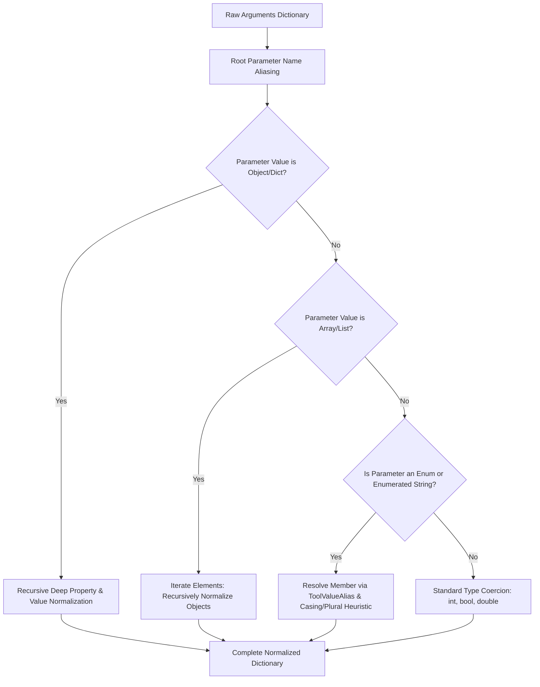

# Pmad.AI SLM Pipeline Optimization & Resilient Dispatch Plan

**Document Version:** 1.0  
**Date:** October 19, 2026  
**Status:** Approved for Implementation  
**Target:** `Pmad.AI`, `Pmad.AI.SourceGenerators`, and `Pmad.AI.Benchmark`  

---

## 1. Executive Summary & Design Principles

Following the empirical benchmark evaluation in [benchmark-qwen35-4b-report.md](benchmark-qwen35-4b-report.md), this document establishes the implementation plan for:
1. **Redesigning `UseRecommendedSlmPipeline`**: Fixing middleware layering inversion and dropping destructive tool result compaction so SLMs retain critical multi-turn coding context.
2. **Tool Call Healing Robustness & Stall Recovery (Item 3)**: Preventing empty responses, handling thinking trace token exhaustion, and recovering unclosed/truncated pseudo-tags using benchmark-derived test payloads.
3. **Enumerated Value & Deep Property Normalization (Item 4)**: Introducing `[ToolValueAlias]` for C# enums and deep JSON objects/arrays in `LenientToolDispatcher` to eliminate AST argument validation mismatches.
4. **LLM Feedback Policy**: Defining an evidence-based strategy on whether to inform the model when a tool call has been healed.

### Core Non-Negotiable Rules
* **Benchmark Integrity:** Under no circumstances will any benchmark scenario, validation check, expected AST value, or scoring metric be weakened or modified. The benchmark must remain difficult (SLM pass rate ceiling $\le 70\%$).
* **Harness Agnostic & AOT-Ready:** All utilities must remain harness-neutral, high-performance, and compatible with Native AOT through Roslyn incremental source generation.

---

## 2. New Preset: `UseRecommendedSlmPipeline`

### 2.1 Middleware Ordering Rationale (The Onion Inversion Fix)

In Microsoft.Extensions.AI, `ChatClientBuilder.Use(factory)` wraps the preceding client:
* The **first** `.Use(...)` call wraps `innerClient` directly (inner-most delegator, closest to inference).
* The **last** `.Use(...)` call wraps everything (outer-most delegator, invoked first on incoming requests).

In the previous implementation, `UseToolCallHealing` was placed last (outer-most), while `UseLenientToolDispatch` was placed first (inner-most). When a raw SLM emitted pseudo-tags (`<tool_call>`), the inner dispatcher saw only raw text and could not normalize names or parameters. Healing then extracted the calls at the very outer edge, bypassing dispatcher normalization entirely.

**Target Middleware Hierarchy (Request Flow $\downarrow$ | Response Flow $\uparrow$):**

```
Incoming Request (User/Agent)
              │
              ▼
┌────────────────────────────────────────────────────────┐
│ 4. ThinkingTraceCompactionChatClient (Summarizer=null) │  (Trims older reasoning traces on input)
└────────────────────────────────────────────────────────┘
              │
              ▼
┌────────────────────────────────────────────────────────┐
│ 3. ToolLoopCircuitBreakerChatClient                    │  (Monitors canonical normalized calls for loops)
└────────────────────────────────────────────────────────┘
              │
              ▼
┌────────────────────────────────────────────────────────┐
│ 2. LenientToolDispatchChatClient                       │  (Normalizes names, aliases, parameter types/values)
└────────────────────────────────────────────────────────┘
              │
              ▼
┌────────────────────────────────────────────────────────┐
│ 1. ToolCallHealingChatClient                           │  (Converts raw fences, pseudo-tags & repairs JSON)
└────────────────────────────────────────────────────────┘
              │
              ▼
Raw IChatClient (e.g., LlamaSharp / Ollama)
```

### 2.2 Deep Dive: Dropping `UseToolResultCompaction` from the SLM Preset

#### Decision: Completely Remove `UseToolResultCompaction` from `UseRecommendedSlmPipeline`

1. **Why Tool Result Compaction Hurts SLMs:**
   In agentic software engineering (SWE-bench), tool outputs consist of exact line numbers, compiler diagnostics, file excerpts, and test failure stack traces. Even conservative truncation cuts the exact anchor tokens an SLM requires to generate accurate search-and-replace patches. In the benchmark, configurations without tool result compaction (`opt-lenient-dispatch`) achieved the highest pass rates (8/15 passed, 2/7 SWE-bench), whereas configurations with tool result compaction saw degradation.
2. **Context Headroom of Modern Models:**
   Qwen 3.5 4B and Qwen 3.6 35B demonstrated **100% accuracy on RULER up to 16,000 context tokens**. Because modern SLMs comfortably process 16k–32k context windows, tool results across standard multi-turn workflows fit well within model memory without truncation.
3. **Purity of Observations:**
   By completely dropping `UseToolResultCompaction` from `UseRecommendedSlmPipeline`:
   * All tool execution outputs (git diffs, test outputs, file reads) remain **100% verbatim and lossless**.
   * Reasoning traces are still trimmed via `ThinkingTraceCompaction` (which operates strictly on internal thoughts and preserves tokens without touching external tool observations).
   * Developers working in extreme low-memory environments can still manually attach `UseToolResultCompaction` to their `ChatClientBuilder`, but it is not part of the standard SLM recommendation preset.

### 2.3 Proposed Preset Implementation

```csharp
public static ChatClientBuilder UseRecommendedSlmPipeline(
    this ChatClientBuilder builder,
    LenientToolDispatcher? dispatcher = null,
    Action<ToolCallHealingOptions>? configureHealing = null,
    Action<ToolLoopCircuitBreakerOptions>? configureBreaker = null,
    Action<ThinkingTraceCompactionOptions>? configureThinking = null)
{
    ArgumentNullException.ThrowIfNull(builder);

    // 1. Tool Call Healing wraps raw client (inner-most).
    // Intercepts raw pseudo-tags (<tool_call>), fences, and unescaped JSON strings.
    if (dispatcher != null)
    {
        builder.UseToolCallHealing(dispatcher, options =>
        {
            options.EnforceAvailableToolsGuardrail = true;
            configureHealing?.Invoke(options);
        });
    }
    else
    {
        builder.UseToolCallHealing(options =>
        {
            options.EnforceAvailableToolsGuardrail = true;
            configureHealing?.Invoke(options);
        });
    }

    // 2. Lenient Tool Dispatcher wraps healing.
    // Receives FunctionCallContent from both native tool calls and healed pseudo-tags,
    // normalizes aliases, strips namespaces, coerces argument types, and maps value synonyms.
    builder.UseLenientToolDispatch(dispatcher);

    // 3. Tool Loop Circuit Breaker wraps Lenient Dispatch.
    // Inspects canonical, normalized tool calls to trip repetitive loops and ping-pong patterns.
    builder.UseToolLoopCircuitBreaker(dispatcher, options =>
    {
        options.PingPongThreshold = 3;
        options.ResetOnUserPrompt = true;
        options.MaxToolHistory = 30;
        configureBreaker?.Invoke(options);
    });

    // 4. Thinking Trace Compaction trims reasoning traces outside active turn window.
    // Strictly deterministic (Summarizer = null) to preserve KV-cache stability.
    builder.UseThinkingTraceCompaction(options =>
    {
        options.KeepVerbatimCount = 5;
        options.FallbackCharacterLimit = 2000;
        options.FallbackPrefixLength = 1400;
        options.FallbackSuffixLength = 600;
        options.Summarizer = null;
        configureThinking?.Invoke(options);
    });

    return builder;
}
```

---

## 3. Part 2: Tool Call Healing Robustness & Test Payloads

### 3.1 Failure Modes Identified from Transcripts

1. **Thinking Budget Exhaustion (BFCL Irrelevance Turn 2):**
   The model generated 2,048 tokens of internal thinking (`<think> ...`), exhausting the maximum turn generation budget before emitting the closing `</think>` tag or final text answer. The downstream parser stripped unclosed tags and found zero text, resulting in `Validation Failure: assistant returned empty output`.
2. **Unclosed / Truncated Pseudo-Tags (BFCL Simple FC Turn 15):**
   The model began outputting `<tool_call>{"name": "find_real_estate", ...}` but was cut off before `</tool_call>`. The strict regex failed to match, leaving raw text instead of promoting to `FunctionCallContent`.
3. **Empty Text Stripping:**
   When pseudo-tags were stripped from messages containing only whitespace, `message.Contents` became empty, causing protocol-level validation errors.

### 3.2 Recovery Mechanisms to Implement in `ToolCallHealingTransform.cs`

1. **Unclosed Pseudo-Tag Parser (`TryExtractUnclosedToolCall`):**
   When content begins with `<tool_call>` or `<function_call>` without a closing tag, scan forward and extract balanced JSON `{ ... }`. If valid or repairable, promote to `FunctionCallContent` and strip only the extracted prefix.
2. **Thinking Trace Runaway Protection:**
   If the entire response is an unclosed `<think>` block that exhausted the generation limit, preserve the thought content as text or extract the last coherent thought draft rather than returning an empty content collection.
3. **Non-Empty Text Safeguard:**
   In `HealChatMessage`, if stripping pseudo-tags reduces text content to whitespace and no tool calls were extracted, retain the trimmed text content to prevent emitting invalid empty messages.

### 3.3 Benchmark-Derived Test Payloads for Unit Tests

The following payloads are extracted directly from benchmark transcripts and failure cases to be incorporated into `ToolCallHealingChatClientTests.cs`:

#### Payload 1: Truncated / Unclosed Pseudo-Tag (BFCL Simple FC Turn 15)
```text
<tool_call>
{"name": "find_real_estate", "arguments": {"location": "San Diego, CA", "property_type": "villa", "bedrooms": 3, "budget": {"min": 300000, "max": 400000}}}
```
*(Notice: Missing `</tool_call>`. Expected outcome: Promoted to `FunctionCallContent("find_real_estate", ...)`, stripped text = empty, `FinishReason = ToolCalls`).*

#### Payload 2: ReAct Action with Fenced Code Block (Mock SWE-bench Turn 3)
```text
I will search for the relevant class in the repository.

Action: search_code
Action Input: ```json
{
  "query": "class ConnectionPoolManager",
  "path": "src/Pmad.Security"
}
```
Let me know if you need more details.
```
*(Expected outcome: Promoted to `FunctionCallContent("search_code", ...)`. Prose before: "I will search...", prose after: "Let me know...", markdown fences cleanly stripped from arguments).*

#### Payload 3: Thinking Trace Runaway with Truncation (BFCL Irrelevance Turn 2)
```text
<think>
Thinking Process:
1. Analyze request: explain synchronous vs asynchronous in two sentences.
2. Draft sentence 1: Synchronous programming executes tasks sequentially...
3. Draft sentence 2: Asynchronous programming allows tasks to run concurrently...
4. Refining comparison: blocking vs non-blocking...
```
*(Notice: Generation limit hit at 2048 tokens, no `</think>` tag, no final text. Expected outcome: Does not produce an empty message; retains text or safely surfaces the response without protocol violation).*

#### Payload 4: Trailing Commas & Unescaped Quotes in Arguments
```text
<tool_call>
{
  "name": "apply_patch",
  "arguments": {
    "file_path": "sympy/matrices/dense.py",
    "patch": "--- a/dense.py\n+++ b/dense.py\n@@ -10,3 +10,3 @@\n- old_code()\n+ new_code()\n",
  }
}
</tool_call>
```
*(Expected outcome: Trailing comma before `}` stripped, multiline patch with unescaped newlines parsed cleanly).*

---

## 4. Part 3: Enumerated Value Healing & Deep Property Normalization

### 4.1 Objectives & Requirements
* **Enums & Enumerated Types:** Support real C# enums, string-based enum sets, and integer codes.
* **Declarative Enum Attributes:** Allow `[ToolValueAlias]` directly on enum member definitions.
* **Deep JSON Traversal:** Normalization must not be limited to top-level parameters; it must recursively inspect nested JSON objects and arrays of objects (e.g. `edits: [{ old_text: "...", new_text: "..." }]`).
* **Source-Generated:** Zero reflection at runtime via Roslyn incremental generation.

### 4.2 Attributes Architecture

#### 1. `ToolValueAliasAttribute` (on Enum Members & Properties)
```csharp
namespace Pmad.AI.Tools;

/// <summary>
/// Specifies alternative names, aliases, or common SLM misnomers for an enum member or property value.
/// </summary>
[AttributeUsage(AttributeTargets.Field | AttributeTargets.Property, AllowMultiple = false)]
public sealed class ToolValueAliasAttribute : Attribute
{
    public string[] Aliases { get; }

    public ToolValueAliasAttribute(params string[] aliases)
    {
        Aliases = aliases ?? [];
    }
}
```

#### 2. `ToolParameterValueAliasAttribute` (on Methods & Parameters)
```csharp
namespace Pmad.AI.Tools;

/// <summary>
/// Maps argument value aliases (synonyms, casing variations, plurals) to canonical values.
/// Can be applied to a tool method or directly to a parameter.
/// </summary>
[AttributeUsage(AttributeTargets.Method | AttributeTargets.Parameter, AllowMultiple = true)]
public sealed class ToolParameterValueAliasAttribute : Attribute
{
    public string ParameterName { get; }
    public string CanonicalValue { get; }
    public string[] Aliases { get; }

    public ToolParameterValueAliasAttribute(string parameterName, string canonicalValue, params string[] aliases)
    {
        ParameterName = parameterName;
        CanonicalValue = canonicalValue;
        Aliases = aliases ?? [];
    }
}
```

### 4.3 Concrete Examples & Use Cases

#### Example A: Real C# Enum with Member Aliases
```csharp
public enum ResourceType
{
    [ToolValueAlias("memory", "memory_limit", "mem", "ram")]
    MemoryMb,

    [ToolValueAlias("cpu", "cpu_limit", "cores", "vcpu")]
    CpuCores,

    [ToolValueAlias("storage", "disk", "disk_size")]
    StorageGb
}
```
*If an SLM outputs `resource_type: "memory_limit"` or `"memory"`, the dispatcher maps it directly to `ResourceType.MemoryMb`.*

#### Example B: Tool Method with String Enumerated Value Aliases
```csharp
[Tool("calculate_effective_population_size")]
[ToolParameterValueAlias("species", "wild tiger", "wild tigers", "tiger", "tigers")]
[ToolParameterValueAlias("species", "african elephant", "african elephants", "elephant")]
public double CalculatePopulation(string species, int censusCount) { ... }
```
*Resolves Turn 20 of BFCL Multiple Tools (`"wild tigers"` $\rightarrow$ `"wild tiger"`).*

#### Example C: Deep JSON Object & Array Normalization
Given tool parameter `IReadOnlyList<EditChunk> edits`:
```json
{
  "edits": [
    {
      "target_content": "oldCode();",
      "replacement_content": "newCode();"
    }
  ]
}
```
The dispatcher recursively normalizes each element in `edits`:
* `target_content` $\rightarrow$ `oldText`
* `replacement_content` $\rightarrow$ `newText`
* If `EditChunk` has an enum property (e.g. `EditMode`), enum value aliases are also resolved deeply.

### 4.4 Dispatcher Normalization Algorithm



---

## 5. Architectural Decision: Informing the LLM About Healing

### 5.1 The Question
*When healing is done, should we inform the LLM about what we did to repair its call?*

### 5.2 Comparative Analysis

| Strategy | Mechanism | Pros | Cons | Benchmark Impact |
| :--- | :--- | :--- | :--- | :--- |
| **Option A: Silent / Transparent (Recommended)** | Tool executes cleanly; arguments in conversation history reflect canonical state. Zero feedback text injected. | • Maximum forward momentum.<br/>• No prompt token overhead.<br/>• Zero defensive apologies from SLM. | Model does not "learn" the mistake within that single conversation session. | **Safest**: 100% compliant with strict benchmark AST assertions. |
| **Option B: Tool Result Annotation** | Append notice inside tool result JSON: `_notice: "Normalized 'memory' to 'memory_mb'"` | Model sees the correction in the next turn context without altering role schema. | • Small models (4B) often latch onto notices and apologize instead of continuing work.<br/>• Pollutes tool output for diff parsers. | **Risky**: Can trigger unexpected model commentary or break mock regex checks. |
| **Option C: Explicit System Correction** | Inject a separate system message: `System: Your tool call was repaired...` | Explicit feedback. | • Triggers defensive behavior in SLMs.<br/>• Consumes context.<br/>• Breaks alternating user/assistant turn expectations. | **Harmful**: Frequently derails small models on multi-turn coding benchmarks. |

### 5.3 Adopted Policy: 100% Silent Execution

1. **Strictly Silent Execution:**
   When `ToolCallHealing` or `LenientToolDispatcher` repairs a tag, strips fences, coerces types, or normalizes an argument (root or deep), the repair is made completely transparently. The tool executes, and the canonical result is returned normally. Zero explanatory text, apologies, or feedback annotations are injected into the conversation.
2. **Telemetry-Only Observability:**
   All healing events and normalizations are recorded in `ToolCallHealingTelemetry` and `LenientDispatchTelemetry` for developer observability, benchmark telemetry matrices, and production audit logs.
3. **Loop Breaker Exception:**
   Only when the model enters an infinite repetitive loop or when the circuit breaker trips is an advisory message injected into the conversation history:
   `"Tool loop detected. Stop calling {tool} with identical arguments and proceed to your final response."`

---

## 6. Implementation Roadmap & Verification

| Milestone | Key Deliverables | Target Files | Verification Method |
| :--- | :--- | :--- | :--- |
| **Milestone 1** | Redesign `UseRecommendedSlmPipeline` preset with proper onion layering (Healing $\rightarrow$ Dispatch $\rightarrow$ Breaker $\rightarrow$ ThinkingCompaction) and drop `UseToolResultCompaction`. | `ChatClientBuilderExtensions.cs` | `PipelinePresetsTests.cs` |
| **Milestone 2** | Add benchmark test payloads; implement unclosed tag scanner and empty-output guard. | `ToolCallHealingTransform.cs`<br/>`ToolCallHealingChatClient.cs` | `ToolCallHealingChatClientTests.cs` |
| **Milestone 3** | Implement `[ToolValueAlias]`, `[ToolParameterValueAlias]`, deep object/array traversal, and source generator updates. | `ToolAttributes.cs`<br/>`LenientToolDispatcher.cs`<br/>`ToolDispatcherGenerator.cs` | `LenientToolDispatcherTests.cs`<br/>`ToolDispatcherSourceGeneratorTests.cs` |
| **Milestone 4** | Run full benchmark replay with Qwen 3.5 4B to empirically validate task improvement without weakening the benchmark. | `benchmarks/Pmad.AI.Benchmark` | Full benchmark run against BFCL, SWE-bench, and RULER. |
