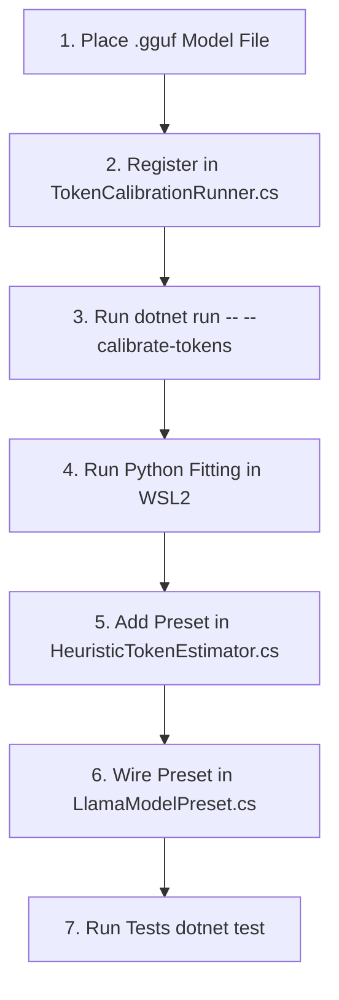

# Token Estimator Calibration Guide

This guide details how to empirically calibrate and add new model family presets for [`HeuristicTokenEstimator`](../src/Pmad.AI/Tokens/HeuristicTokenEstimator.cs).

---

## 1. Overview & Architecture

### Why Heuristic Token Estimation?
1. **Zero Allocations & Sub-Microsecond Speed:** Operates directly over `ReadOnlySpan<char>` with 0 MB GC heap allocation and ~100x lower latency than full BPE tokenization.
2. **Crash Prevention on Large Prompts:** Native llama.cpp `llama_tokenize` can trigger unmanaged access violations (`0xC0000005`) or stack overflows on very large prompt strings (>8 KB). `HeuristicTokenEstimator` provides safe, deterministic estimation for rate-limiting, context budgeting, and compaction triggers.

### Mathematical Formulation
The token estimation heuristic is defined as:

$$\text{Tokens} = \max\left(\left\lceil w_{\text{word}} \cdot \text{words} + w_{\text{sym}} \cdot \text{symbols} + w_{\text{nonAscii}} \cdot \text{nonAscii}\right\rceil, \left\lceil \frac{\text{chars}}{\text{charFloorFactor}}\right\rceil\right)$$

Where:
- **`words`**: Count of ASCII alphanumeric sequences (`char.IsLetterOrDigit`).
- **`symbols`**: Count of ASCII punctuation and formatting characters.
- **`nonAscii`**: Count of non-ASCII / Unicode code points ($c > 127$).
- **`chars`**: Total character length of the text (`text.Length`).
- **`charFloorFactor`**: Divisor enforcing a minimum token floor on dense, unspaced strings (e.g., base64, hexadecimal dumps, hashes).

---

## 2. Calibrated Presets Reference

The current empirical factors measured across 451 ground-truth samples:

| Preset | Target Model Families | WordFactor | SymbolFactor | NonAsciiFactor | CharFloorFactor | MAE | RMSE | Mean Bias |
| :--- | :--- | :---: | :---: | :---: | :---: | :---: | :---: | :---: |
| **`Default`** | General-purpose fallback | `1.25` | `0.80` | `1.00` | `3.8` | 24.54 | 34.04 | +11.61 |
| **`Qwen`** | Qwen 3.5, 3.6, 3.8 | **`1.36`** | **`0.66`** | **`0.40`** | **`3.8`** | **20.10** | **27.64** | **+4.78** |
| **`Gemma`** | Gemma 4 (E2B, E4B, 12B, 26B, 31B) | **`1.43`** | **`0.72`** | **`0.37`** | **`3.6`** | **19.66** | **26.86** | **+5.37** |

> [!NOTE]
> **Non-ASCII Efficiency:** Early heuristics assumed `NonAsciiFactor = 1.0`. Modern large-vocabulary BPE tokenizers (Qwen's 152k and Gemma's 262k) merge accented Latin characters (French, German, Spanish) and CJK glyphs into shared multi-byte tokens, yielding an empirical factor of `~0.37 - 0.40`.

---

## 3. Calibration Workflow for New Models

When adding a new model family (e.g. Llama 3, Mistral, Command-R, DeepSeek):



### Step 1: Obtain the Model GGUF File
Place the `.gguf` file in your local model cache (e.g. `C:\Workspace\models\<model_name>\...` or `~/.pmad/models`). Full GPU execution is **not** required; LLamaSharp will load only the vocabulary table.

### Step 2: Register Model in `TokenCalibrationRunner.cs`
Open [`benchmarks/Pmad.AI.Benchmark/Tools/TokenCalibrationRunner.cs`](../benchmarks/Pmad.AI.Benchmark/Tools/TokenCalibrationRunner.cs) and add your model path candidate to `DiscoverAvailableModels()`:

```csharp
("Llama3", "llama-3.2-3b", @"C:\Workspace\models\llama-3.2-3b\llama-3.2-3b-instruct-q4_k_m.gguf"),
```

> [!TIP]
> `TokenCalibrationRunner` sets `VocabOnly = true` and `GpuLayerCount = 0`. Even a 70B parameter model will load its tokenizer in under 1 second using ~50 MB of system RAM without touching GPU VRAM.

### Step 3: Run the Empirical Token Collector
Execute the calibration runner from PowerShell:

```powershell
dotnet run --project benchmarks\Pmad.AI.Benchmark\Pmad.AI.Benchmark.csproj -- --calibrate-tokens
```

This scans all registered models across the 7 calibration categories (C#, Python, Web, SQL/JSON Data, ChatML/AI Dialogue, Multilingual Prose, and Dense Adversarial) and exports:
```
benchmarks\Pmad.AI.Benchmark\bin\Debug\net10.0\token_calibration_data.csv
```
Copy or preserve this file in `benchmarks/Pmad.AI.Benchmark/Fixtures/token_calibration_data.csv`.

### Step 4: Run Statistical Regression via WSL2 Python
Run the statistical fitting script using Python in WSL2:

```bash
wsl.exe python3 /mnt/c/Users/Julien/source/repos/jetelain/PmadAI/scripts/calibrate_token_estimator.py
```

The script performs:
1. **Bounded Least Squares (BVLS/NNLS):** Fits $w_{\text{word}}, w_{\text{sym}}, w_{\text{nonAscii}}$ bounded to positive values on structured language and code text.
2. **Floor Factor Search:** Evaluates minimum character floor thresholds against adversarial samples (hashes, unspaced digit strings, base64) to minimize underestimation.
3. **Safety Tuning:** Optimizes asymmetric loss to penalize underestimation 2.5× more heavily than overestimation, ensuring LLM context budgets do not overflow in production.

The script outputs ready-to-use C# code and comparative metrics.

### Step 5: Define the C# Preset
In [`src/Pmad.AI/Tokens/HeuristicTokenEstimator.cs`](../src/Pmad.AI/Tokens/HeuristicTokenEstimator.cs), add the public static preset:

```csharp
/// <summary>
/// Gets a preset fine-tuned for Llama 3 models based on empirical tokenizer calibration.
/// </summary>
public static HeuristicTokenEstimator Llama3 { get; } = new(
    wordFactor: 1.32,
    symbolFactor: 0.68,
    nonAsciiFactor: 0.45,
    charFloorFactor: 3.8);
```

### Step 6: Wire Preset in `LlamaModelPreset.cs`
In [`src/Pmad.AI.LlamaSharp/LlamaModelPreset.cs`](../src/Pmad.AI.LlamaSharp/LlamaModelPreset.cs):
1. Assign `TokenEstimator = HeuristicTokenEstimator.Llama3` to the preset definition.
2. Update `Find(string? identifier)` lookup logic if new aliases were introduced.

Once configured, [`LlamaSharpChatClient`](../src/Pmad.AI.LlamaSharp/LlamaSharpChatClient.cs) will automatically select the calibrated estimator when loading the model.

### Step 7: Validate with Tests
Add test cases in:
- [`tests/Pmad.AI.Tests/HeuristicTokenEstimatorTests.cs`](../tests/Pmad.AI.Tests/HeuristicTokenEstimatorTests.cs) (checking factor values and estimation).
- [`tests/Pmad.AI.LlamaSharp.Tests/LlamaModelPresetTests.cs`](../tests/Pmad.AI.LlamaSharp.Tests/LlamaModelPresetTests.cs) (checking preset resolution and `TokenEstimator` wiring).

Run the tests:
```powershell
dotnet test tests\Pmad.AI.Tests\Pmad.AI.Tests.csproj
dotnet test tests\Pmad.AI.LlamaSharp.Tests\Pmad.AI.LlamaSharp.Tests.csproj
```

---

## 4. Diagnostic & Feature Extraction API

You can programmatically extract structural token metrics directly using the zero-allocation `Analyze` API:

```csharp
using Pmad.AI.Tokens;

ReadOnlySpan<char> text = "public async Task<int> GetCountAsync();".AsSpan();

// Measure the 4 structural metrics without heap allocation:
TokenMetrics metrics = HeuristicTokenEstimator.Analyze(text);
Console.WriteLine($"Words: {metrics.Words}");
Console.WriteLine($"Symbols: {metrics.Symbols}");
Console.WriteLine($"Non-ASCII: {metrics.NonAscii}");
Console.WriteLine($"Characters: {metrics.CharCount}");

// Estimate using pre-computed metrics:
int qwenEstimate = HeuristicTokenEstimator.Qwen.Estimate(in metrics);
int gemmaEstimate = HeuristicTokenEstimator.Gemma.Estimate(in metrics);
```

---

## 5. Safety Margin Headroom in `SafeCountInputTokens`

Because heuristic tokenization relies on statistical factors, variance can occasionally underestimate token counts for edge-case prompts (e.g. dense unbroken digit runs or code patterns).

To guarantee that callers (context window managers, compaction triggers, and rate limiters) never overflow model context or under-budget usage, `LlamaSharpOptions` applies a safety headroom margin when estimating:

```csharp
var options = new LlamaSharpOptions
{
    // +5% headroom applied when SafeCountInputTokens estimates heuristically (prompts > 8 KB or native tokenizer fallbacks)
    EstimatedTokenSafetyMargin = 0.05
};

using var client = LlamaSharpChatClient.CreateFromFile(modelPath, options);
```

You can also configure `SafetyMargin` directly on any custom `HeuristicTokenEstimator`:

```csharp
var safeEstimator = new HeuristicTokenEstimator(
    wordFactor: 1.36,
    symbolFactor: 0.66,
    nonAsciiFactor: 0.40,
    charFloorFactor: 3.8,
    safetyMargin: 0.05); // +5% headroom
```
